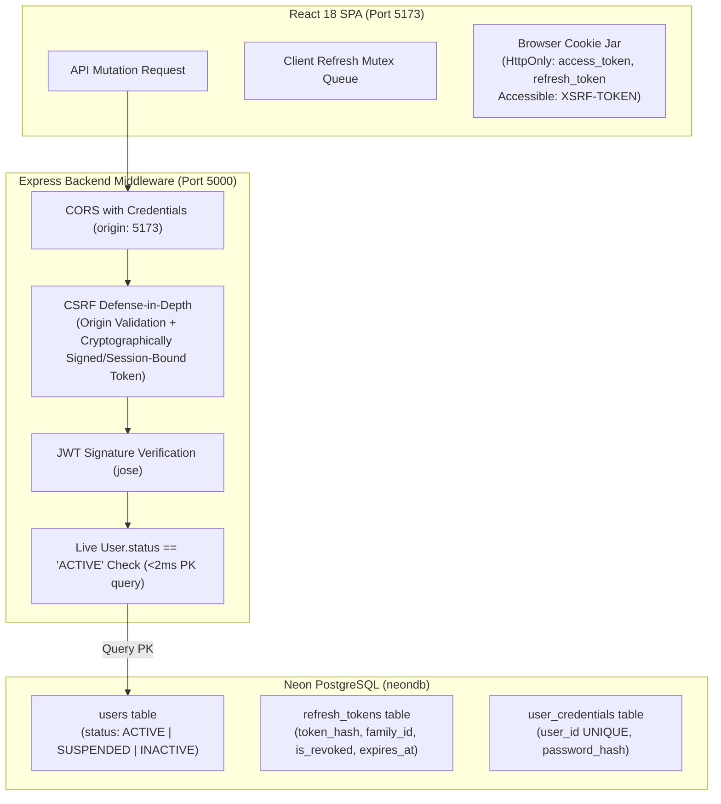

# Architecture Decision Record: Decision Q-01 (Authentication Strategy)

**Document Identifier:** `DECISION_RECORD_Q01_AUTHENTICATION_STRATEGY`  
**Decision Reference:** **Decision Q-01** (Authentication Implementation Choice & Identity Decoupling)  
**Status:** **APPROVED / RESOLVED by Project Owner**  
**Decision Date:** 25 October 2026  
**Branch:** `dev`  
**Normative Authorities:**
- [`docs/project-baseline/refined/FINAL_DECISIONS_AND_SUPERSEDING_CORRECTIONS.md`](file:///c:/Users/shrey/Desktop/AICTE-Approval-Workflow/docs/project-baseline/refined/FINAL_DECISIONS_AND_SUPERSEDING_CORRECTIONS.md)
- [`docs/contract-review/PHASE_3_CP3_AUTHENTICATION_DESIGN_REVIEW.md`](file:///c:/Users/shrey/Desktop/AICTE-Approval-Workflow/docs/contract-review/PHASE_3_CP3_AUTHENTICATION_DESIGN_REVIEW.md)
- [`docs/project-baseline/refined/api-specifications_FINAL.md`](file:///c:/Users/shrey/Desktop/AICTE-Approval-Workflow/docs/project-baseline/refined/api-specifications_FINAL.md)
- [`docs/project-baseline/refined/DATABASE_SCHEMA_REVISION_2.md`](file:///c:/Users/shrey/Desktop/AICTE-Approval-Workflow/docs/project-baseline/refined/DATABASE_SCHEMA_REVISION_2.md)
- [`docs/contract-review/PHASE_2_CONTRACT_REVIEW.md`](file:///c:/Users/shrey/Desktop/AICTE-Approval-Workflow/docs/contract-review/PHASE_2_CONTRACT_REVIEW.md)
- [`docs/contract-review/PHASE_3_CP7D_NEON_MIGRATION_EXECUTION_REPORT.md`](file:///c:/Users/shrey/Desktop/AICTE-Approval-Workflow/docs/contract-review/PHASE_3_CP7D_NEON_MIGRATION_EXECUTION_REPORT.md)

---

## 1. Context and Problem Statement

The AICTE Approval Workflow Automation system requires a secure, high-performance authentication and session management subsystem. 

In accordance with [`FINAL_DECISIONS_AND_SUPERSEDING_CORRECTIONS.md`](file:///c:/Users/shrey/Desktop/AICTE-Approval-Workflow/docs/project-baseline/refined/FINAL_DECISIONS_AND_SUPERSEDING_CORRECTIONS.md) (§1, §2, §4), the following architectural boundaries are firmly established:
1. **Better Auth is strictly excluded.**
2. **Neon Realtime and Neon Auth are strictly excluded.**
3. **Storing bearer or session tokens in browser `localStorage` or `sessionStorage` is strictly prohibited.**
4. The approved technology direction was narrowed to two candidate alternatives:
   - *Option A:* An Auth.js-compatible solution (`@auth/express` + Prisma adapter).
   - *Option B:* Custom Express JWT authentication with secure HTTP-only cookies and database-backed refresh token rotation.

Phase 3 Checkpoint 3 ([`PHASE_3_CP3_AUTHENTICATION_DESIGN_REVIEW.md`](file:///c:/Users/shrey/Desktop/AICTE-Approval-Workflow/docs/contract-review/PHASE_3_CP3_AUTHENTICATION_DESIGN_REVIEW.md)) presented a comparative evaluation of both options. Following the successful application of the foundational identity/RBAC schema migration in CP-7 ([`PHASE_3_CP7D_NEON_MIGRATION_EXECUTION_REPORT.md`](file:///c:/Users/shrey/Desktop/AICTE-Approval-Workflow/docs/contract-review/PHASE_3_CP7D_NEON_MIGRATION_EXECUTION_REPORT.md)), the project owner reviewed the findings and rendered formal decisions on all core Q-01 architecture items.

This document formally records the resolution of **Decision Q-01**, codifies the approved architecture, and specifies the security constraints and implementation prerequisites.

---

## 2. Confirmed Owner Decisions

The project owner has formally confirmed the following decisions for Q-01:

| # | Decision Area | Confirmed Owner Decision | Implementation Principle |
|---|---|---|---|
| **1** | **Architecture Selection** | **Option B: Custom Express JWT with Secure HTTP-Only Cookies** | Natively integrates with Express REST API and Vite React SPA without SSR/Next.js abstractions. |
| **2** | **Credential Storage Model** | **Separate `user_credentials` table** | Preserves the provider neutrality of the core `users` table. Zero password hashes or auth tokens are stored in `users`. |
| **3** | **Suspension Enforcement** | **Per-Request Active Status Check** | `authenticate` middleware verifies `User.status == 'ACTIVE'` on every protected HTTP request and privileged Socket.IO event; active sockets are reliably evicted upon suspension. |
| **4** | **Refresh-Token Strategy** | **Strict Single-Use Rotation** | Enforces client-side refresh mutex, atomic server-side consumption, and reuse detection. **Server-side grace windows, silent replay of raw replacement tokens based on hash, and IP/UA fingerprint bypasses are strictly rejected.** |
| **5** | **Token Library** | **`jose`** | Native ESM, zero-dependency, Web Crypto API-based token signing/verification with bundled TypeScript types. |
| **6** | **Password Hashing** | **`@node-rs/argon2`** | Memory-hard Argon2id algorithm (OWASP standard) with bundled TypeScript types, subject to runtime environment compatibility verification. |
| **7** | **Cookie Parsing** | **`cookie-parser`** | Standard Express cookie middleware with `@types/cookie-parser`. |

---

## 3. Decision Rationale

The project owner selected **Option B (Custom Express JWT with Secure HTTP-Only Cookies)** over Option A for the following primary reasons:

1. **Decoupled Architecture Fit:**
   The AICTE platform is structured as an independent client-side Single Page Application (React 18 + Vite on port `5173`) communicating with a stateless Express backend (port `5000`). Option B provides clean, standard REST endpoints (`/login`, `/logout`, `/refresh`, `/me`) without the redirection and session-synchronization friction of full-stack SSR frameworks.
2. **Socket.IO Native Integration:**
   Real-time notifications use Socket.IO ([`FINAL_DECISIONS_AND_SUPERSEDING_CORRECTIONS.md`](file:///c:/Users/shrey/Desktop/AICTE-Approval-Workflow/docs/project-baseline/refined/FINAL_DECISIONS_AND_SUPERSEDING_CORRECTIONS.md) §1, §3). Handshake authentication and active socket eviction upon user suspension require transparent access to token parsing and database status lookups. `@auth/express` obscures session decryption behind internal JWE abstractions without an official Socket.IO handshake adapter.
3. **Framework Stability and Lifecycle:**
   `@auth/express` is currently an experimental/beta package in Auth.js v5 with frequent breaking changes. In contrast, Option B utilizes stable, battle-tested, standard primitives (`jose`, `@node-rs/argon2`).
4. **Minimal and Modular Schema Footprint:**
   Option B avoids the schema bloat mandated by Auth.js (`Account`, `Session`, `VerificationToken`), adding only a minimal `refresh_tokens` table and a decoupled `user_credentials` table.
5. **Deterministic Regulatory Enforcement:**
   Statutory AICTE regulatory workflows mandate immediate, non-negotiable suspension enforcement and auditable session revocation. Option B allows exact control over the middleware execution pipeline.

---

## 4. Security Requirements & Technical Specifications



### 4.1 Token Storage, Lifetimes, and Cookie Configuration
- **Strict JavaScript Inaccessibility:** Under no circumstances may access tokens, refresh tokens, signing secrets, or credentials be written to `localStorage`, `sessionStorage`, or window global variables. Both `access_token` and `refresh_token` cookies must remain strictly `HttpOnly: true` across all environments.
- **Production Transport Security:** `Secure: true` is strictly required in production (`process.env.NODE_ENV === 'production'`) to mandate HTTPS transport.
- **Topology-Aware Cookie Scoping:** Cookie `Domain`, `Path`, and `SameSite` settings must be chosen deliberately based on the deployed origin topology:
  - In a decoupled cross-origin development topology (`localhost:5173` frontend and `localhost:5000` backend with CORS `credentials: true`), cookies require careful `SameSite` and path alignment.
  - In staging/production environments (e.g., frontend and API reverse-proxied under a common domain or across designated subdomains), cookie domain and `SameSite` policies (`SameSite: 'Lax'` or `'Strict'`) must be configured to ensure cookies are delivered only to authorized API endpoints without cross-site exposure.
- **Provisional Token Lifetimes:**
  - **`access_token`:**
    - `HttpOnly: true` (inaccessible to browser JavaScript).
    - `Secure: true` in production.
    - `SameSite: 'Lax'` (chosen deliberately for deployed origin topology).
    - `Path: '/'`.
    - `maxAge: 15 * 60 * 1000` (**Provisional default: 15 minutes**; subject to operational tuning during implementation).
  - **`refresh_token`:**
    - `HttpOnly: true` (inaccessible to browser JavaScript).
    - `Secure: true` in production.
    - `SameSite: 'Lax'` (chosen deliberately for deployed origin topology).
    - `Path: '/api/v1/auth'` (strictly path-scoped so the refresh token is only transmitted to authentication endpoints, preventing exposure on resource requests).
    - `maxAge: 7 * 24 * 60 * 60 * 1000` (**Provisional default: 7 days**; subject to operational tuning during implementation).

### 4.2 Cross-Site Request Forgery (CSRF) Mitigation
- **Threat Model & Security Vulnerability of Simple Equality:**
  Because authentication relies on ambient credentials (cookies) sent cross-origin or same-site with credentials, state-changing endpoints are vulnerable to CSRF. **Cookie/header equality alone is not sufficient.** Naive double-submit cookie schemes where the server only compares whether an unauthenticated request header matches a readable cookie can be compromised if an attacker can manipulate or inject cookies via shared parent domains, subdomains, or unencrypted network paths.
- **Required Defense-in-Depth Architecture:**
  CSRF protection must use a securely designed signed/session-bound token and rigorous allowed-origin validation as defense-in-depth:
  1. **Cryptographically Signed or Session-Bound Token:** The CSRF token issued to the client must be cryptographically HMAC-signed using a dedicated server secret or cryptographically bound to the authenticated user's session context, ensuring the server can verify the token was authentically generated.
  2. **Rigorously Enforced Origin / Referer Validation:** Mutating state-changing requests (`POST`, `PUT`, `PATCH`, `DELETE`) must rigorously validate the `Origin` and/or `Referer` headers against the server's configured whitelist of allowed client origins (`CLIENT_URL`).
  3. **Deliberate Cookie Scoping:** The `SameSite` attribute must be configured deliberately to prevent ambient cross-site inclusion on untrusted requests.

### 4.3 Immediate Account Suspension Enforcement
- **Statutory Necessity:** When an officer or institution account is marked `SUSPENDED` or `INACTIVE` by an administrator, their capability to mutate regulatory data or access sensitive inspection workflows must cease **immediately**, not after a residual token lifespan expires.
- **Enforcement Pipeline:**
  1. **Protected HTTP Requests:** In the `authenticate` middleware, after cryptographic token signature verification, the server executes:
     ```sql
     SELECT id, status FROM users WHERE id = $1;
     ```
     If `status != 'ACTIVE'`, the request is immediately aborted with `403 Forbidden` and error code `ACCOUNT_SUSPENDED`.
  2. **Socket.IO Handshake Gate:** The Socket.IO connection handshake verifies token cryptographic validity AND queries current account status from the database. Suspended or inactive accounts cannot establish a socket connection.
  3. **Privileged Socket Events:** Before processing any mutating or privileged incoming socket event, the server re-validates account status.
  4. **Reliable Active Socket Eviction:** When an administrative suspension transaction commits in PostgreSQL, an internal event triggers immediate eviction of all active socket connections belonging to that user:
     ```typescript
     io.in(`user:${userId}`).disconnectSockets(true);
     ```

### 4.4 Refresh-Token Rotation & Safe Concurrency Architecture
- **Cryptographic Storage:** Raw refresh tokens are never persisted in plaintext. Only their SHA-256 hashes are stored in `refresh_tokens`.
- **Atomic Rotation:** `/api/v1/auth/refresh` executes inside an atomic PostgreSQL transaction with row-level locking (`SELECT ... FOR UPDATE`). When a token is consumed, it is marked `is_revoked = true` with `revoked_at = NOW()`, and a newly generated pair is inserted.
- **Rejection of Server Grace Windows & Raw Replacement Token Replays:**
  The server-side grace-window proposal previously discussed in CP-3 is **explicitly rejected as unsafe**. Concurrent refresh requests must not silently receive an already-issued raw replacement token based only on its hash. Storing or reissuing raw replacement tokens upon hash matching introduces replay vectors and undermines single-use rotation guarantees.
- **Rejection of Fingerprint-Based Bypass:** Authorizing token reuse based on client IP or User-Agent headers is **strictly rejected**, as these headers are easily spoofed or shared behind institutional proxies.
- **Approved Mitigation & Safe Failure Model:**
  1. *Client-Side Refresh Mutex:* The React SPA API client strictly serializes refresh requests. If multiple API calls fail with `401`, all subsequent calls queue behind a single in-flight refresh promise.
  2. *Limitation of Client Mutex:* The client refresh mutex is an effective in-tab mitigation, but it is **not a complete solution** to cross-tab races or lost responses (e.g., network disconnects after the server consumes the token).
  3. *Safe Failure and Re-authentication:* If ambiguous refresh outcomes occur (such as uncoordinated cross-tab requests or dropped network responses), the server detects a consumed token and enforces reuse detection, revoking the affected token family. The application handles this safely by terminating the session and redirecting the user to log in again with an explicit message: `"Session expired due to concurrent activity. Please log in again."` Silent re-issuance of replacement tokens is prohibited unless a separately reviewed secure recovery mechanism is formally approved in the future.

### 4.5 Separation of Duties & Administrator Authority
- In strict adherence to [`project-architecture.md`](file:///c:/Users/shrey/Desktop/AICTE-Approval-Workflow/docs/project-baseline/refined/project-architecture.md) (§9.3):
  > *"Do not grant official decision authority to a user merely because they are an administrator."*
- System administrators hold operational maintenance privileges (managing users, triggering suspensions, inspecting audit trails). They **never** inherit statutory approval, scrutiny review, or committee recommendation permissions.

### 4.6 Strict Decoupling from Decision Q-09 (RBAC Catalogue)
- **Decision Q-09 remains completely separate and unresolved.**
- This decision record resolves only the identity authentication mechanism, credential storage schema, session lifecycle, and cryptographic dependencies. It does **not** hard-code or approve the final statutory role catalogue or permission matrix.

---

## 5. Implementation Requirements to Finalize and Test

The following technical specifications are recorded as implementation requirements to finalize and test during the authentication implementation checkpoint. These are engineering details rather than new owner governance decisions:

### 5.1 Credential Uniqueness and Storage
- **Uniqueness Constraint:** The `user_credentials` table must enforce credential uniqueness per user (`userId` marked `@unique`, establishing a strict 1:1 relation with `User`). Each user identity has at most one active credential record.
- **Provider Neutrality:** The `users` table remains strictly free of password hashes, salt, or provider-specific credential columns.

### 5.2 Session Invalidation Across Lifecycle Events
The implementation must systematically invalidate sessions and refresh token families upon all critical account lifecycle events:
1. **User Logout:**
   - Revoke the active refresh token family in `refresh_tokens`.
   - Clear `access_token` and `refresh_token` cookies with expired `maxAge`.
2. **Account Suspension:**
   - In addition to immediate HTTP request rejection and active socket eviction, revoke all active refresh token families for the target user in `refresh_tokens`.
3. **Password Reset and Credential Change:**
   - Upon successful credential modification or password reset, revoke all active refresh token families for the user across all devices, forcing full re-authentication.
4. **Automated Lifecycle Testing:**
   - Comprehensive Vitest integration tests must verify session invalidation across logout, password change, and account suspension events.

### 5.3 Technical Verification Items
1. **Argon2 Platform Compatibility Verification:**
   `@node-rs/argon2` relies on pre-built native binaries. Prior to merge, verify clean compilation and execution in target environments without native toolchain errors (fallback: standard `argon2` or `bcrypt` if native compilation fails on target environments).
2. **CSRF Implementation Design:**
   Finalize whether CSRF HMAC tokens will use a static environment secret (`CSRF_SECRET`) or ephemeral session-bound secrets, and verify strict origin header checking.
3. **Password Complexity & Lockout Policies:**
   Define maximum failed login attempts (e.g. 5 attempts) and lockout duration (e.g. 15 minutes) to protect `/api/v1/auth/login` against credential stuffing.
4. **Provisional Token Lifetimes Tuning:**
   The 15-minute access-token and 7-day refresh-token lifetimes are provisional defaults, not owner-approved fixed requirements. Confirm and test operational durations against statutory session risk profiles during the authentication implementation checkpoint.

---

## 6. Implementation Prerequisites & Downstream Roadmap

The following steps are required to implement Decision Q-01 in subsequent checkpoints:

1. **Schema Extension (Prisma):**
   - Add model `UserCredential` to `backend/prisma/schema.prisma` with unique relation to `User`.
   - Add model `RefreshToken` to `backend/prisma/schema.prisma` with relation to `User` and indexes on `userId` and `familyId`.
2. **Migration Generation & Application:**
   - Generate migration `add_auth_credentials_and_tokens`.
   - Apply to Neon `development` branch via `DIRECT_URL`.
3. **Dependency Installation:**
   - Install `jose`, `@node-rs/argon2`, `cookie-parser`.
   - Install dev dependency `@types/cookie-parser`.
4. **Middleware & Route Development:**
   - Implement `backend/src/middleware/auth.middleware.ts` (with per-request `User.status == 'ACTIVE'` verification).
   - Implement `backend/src/middleware/csrf.middleware.ts` (signed/session-bound CSRF token and origin checking).
   - Implement `backend/src/controllers/auth.controller.ts` (`login`, `logout`, `refresh`, `me`).
   - Implement Socket.IO handshake authentication and active-socket eviction in `backend/src/sockets/index.ts`.
5. **Security Test Suite:**
   - Implement comprehensive Vitest regression tests covering token expiry, immediate suspension rejection, socket eviction, CSRF rejection, client refresh mutex serialization, safe failure on concurrent races, and refresh-token reuse detection.
