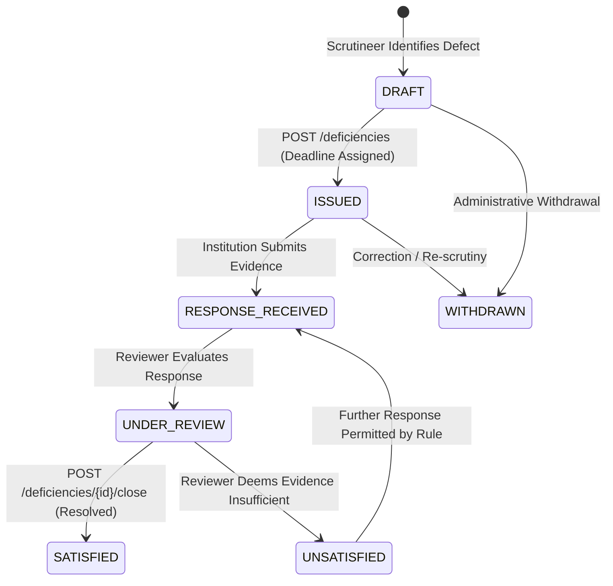
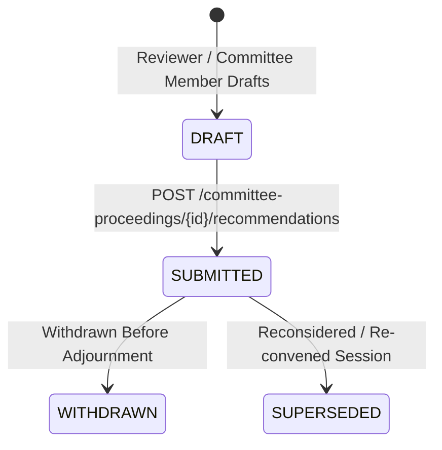

# Phase 2 — Database and API Contract Validation Review

**Project:** Integrated AICTE Approval Workflow Automation, Compliance Monitoring and Alert Management System  
**Document Status:** Authoritative Contract Review & Architectural Alignment Document  
**Review Date:** 25 October 2026 (Revised & Reconciled)  
**Repository Branch:** `dev`  
**Target Delivery Path:** `docs/contract-review/PHASE_2_CONTRACT_REVIEW.md`  

---

## 1. Executive Summary & Document Control

### 1.1 Executive Summary
This document fulfills the requirements of **Phase 2 — Database and API Contract Validation**. It performs an exhaustive static audit and synthesis across the approved project documentation located in `docs/project-baseline/refined/` and the governing problem statement (`PS SIH26262.pdf`) and regulatory reference (`AICTE APH 2024-2027.pdf`).

The primary objective is to produce a verified, internally consistent database and API contract for the system prior to implementing database tables, Prisma migrations, or business features.

Key outcomes established and reconciled in this review:
1. **Preservation of Agreed Project Roadmap (Phase 0–14):** The overarching project lifecycle is governed by the agreed **Phase 0–14 Roadmap** (Phase 0 Scaffolding and Phase 1 Development Foundation completed; Phase 2 Contract Review current). Technical database sequencing is retained strictly as a **Proposed Database Implementation Subplan**, rather than replacing or silently renumbering the master project roadmap.
2. **Entity & Relationship Inventory:** The 42 primary logical entities defined in `DATABASE_SCHEMA_REVISION_2.md` plus required join and link structures are classified into five functional domains, with primary keys, foreign key constraints, cardinalities, and delete/retention invariants fully specified.
3. **Database Identity/RBAC Foundations Decoupled from Authentication (Q-01):** Relational identity and RBAC foundations (`users`, `roles`, `permissions`, `role_permissions`, `user_roles`, `institutions`, and `institution_memberships`) are established as provider-neutral PostgreSQL structures. Session tables, provider identity mappings (`auth_identities`), and authentication-library choices are **NOT mandatory** prior to the owner decision on Q-01, preserving the option to prepare provider-neutral database foundations independently.
4. **API Contract & Operation Inventory:** All 16 domain resource categories (comprising **15 active resource categories with exactly 139 concrete proposed endpoint operations**, plus **1 deferred operational category**) from `api-specifications_FINAL.md` Section 8 are inventoried with request/response envelope schemas, status codes, DTO conventions, and lifecycle readiness statuses matching the source specification 1-to-1.
5. **Lifecycle State Machine Reconciliation:** Formal state machines are cataloged across 12 distinct system dimensions. Enumerated states and transitions for `Deficiency.status`, `Recommendation.status`, and `Application.status` are reconciled directly against `DATABASE_SCHEMA_REVISION_2.md` and `api-specifications_FINAL.md`, strictly separating application technical lifecycles from workflow stages and official decision outcomes.
6. **Separation of Approved Decisions from Implementation Proposals:** Approved canonical requirements are strictly distinguished from implementation proposals. Unapproved concepts—such as `SIMULATED_SUCCESS` as an email status, the strict single-active-workflow-instance rule, and specific private-storage presigned upload/download mechanisms—are explicitly identified as proposals or open choices rather than approved requirements.
7. **Preservation of Statutory Authority:** Explicit boundaries are established separating advisory reviewer observations, formal deficiencies, committee recommendations, factual document verifications, binding official decisions, formal statutory communications, and transient operational notifications/escalations. Autonomous statutory decision-making or penalty imposition is strictly prohibited.
8. **Preservation of Unresolved Decisions:** In areas where the baseline leaves choices open (such as Auth.js-compatible vs. custom JWT with HTTP-only cookies in Q-01), the alternatives, trade-offs, and required owner decisions are presented neutrally without prejudging the outcome or implementing unapproved solutions.
9. **Database Implementation Prerequisites Clarified:** Clear prerequisites are established for Phase 3, identifying Neon PostgreSQL connectivity verification as an essential prerequisite before executing development migrations, while barring premature credential requests or environment modifications during Phase 2.

### 1.2 Hierarchy of Source Authority
When evaluating conflicting statements across documentation files, the following strict order of precedence governs:
1. `FINAL_DECISIONS_AND_SUPERSEDING_CORRECTIONS.md` (Authoritative on final architecture decisions: Auth.js/JWT cookies, Socket.IO, Neon scope).
2. `DATABASE_SCHEMA_REVISION_2.md` (Normative implementation database specification; supplements and refines `DATABASE_SCHEMA.md`).
3. `api-specifications_FINAL.md` (Authoritative REST contract, request/response DTOs, endpoint lifecycle status).
4. `project-requirements.md` and `project-architecture.md` (Functional requirements, system boundaries, security controls).
5. `CROSS_DOCUMENT_CONSISTENCY_AUDIT.md` and `PS_APH_TRACEABILITY_AUDIT.md` (Traceability evidence and conflict identification).
6. `DATABASE_SCHEMA.md` (Baseline conceptual schema; retained for historical context).
7. `AICTE_Antigravity_UI_UX_Specification_FINAL.md` (Visual, interaction, and screen flow guidance; cannot infer statutory rules or database structure).

---

## 2. Source Documents Reviewed

The following canonical baseline documents were reviewed without modification:

| Document File | Purpose / Scope in Contract Validation | Authoritative Scope |
|---|---|---|
| `docs/project-baseline/refined/FINAL_DECISIONS_AND_SUPERSEDING_CORRECTIONS.md` | Authoritative owner corrections on auth, real-time, storage, and Neon service boundaries. | **Highest** (Supersedes prior open/unresolved statuses) |
| `docs/project-baseline/refined/DATABASE_SCHEMA_REVISION_2.md` | Canonical 42-entity relational design, foreign key policies, invariants, and implementation addenda. | **Normative Database Specification** |
| `docs/project-baseline/refined/DATABASE_SCHEMA.md` | Original schema baseline; provides domain context and architectural rationale. | Contextual Baseline (Read alongside Rev 2) |
| `docs/project-baseline/refined/api-specifications_FINAL.md` | Complete REST API endpoint inventory, envelope conventions, DTO schemas, and security rules. | **Normative API Contract** |
| `docs/project-baseline/refined/project-architecture.md` | Modular monolith architecture, backend component boundaries, outbox pattern, and security layers. | System Architecture Baseline |
| `docs/project-baseline/refined/project-requirements.md` | Functional requirements (FR-01 to FR-42), NFRs, RBAC rules (ROLE-001 to ROLE-008), and business logic. | Functional & Non-Functional Baseline |
| `docs/project-baseline/refined/CROSS_DOCUMENT_CONSISTENCY_AUDIT.md` | Inventory of cross-document contradictions (C-01 to C-09) and implementation readiness gates. | Audit & Consistency Baseline |
| `docs/project-baseline/refined/PS_APH_TRACEABILITY_AUDIT.md` | Mapping between SIH 26262 requirements, APH 2024–2027 clauses, and system modules. | Regulatory Traceability Baseline |
| `docs/project-baseline/refined/AUDIT_REPORT.md` | Historical pre-commit review of original baseline documentation package. | Historical Reference |
| `docs/project-baseline/refined/AICTE_Antigravity_UI_UX_Specification_FINAL.md` | Screen structure, component hierarchies, user interaction flows, and form specifications. | UI/UX & Interaction Baseline |

---

## 3. Cross-Document Conflicts and Authoritative Resolutions

The consistency audit identified nine key contradiction areas (C-01 to C-09). Using `FINAL_DECISIONS_AND_SUPERSEDING_CORRECTIONS.md` as the binding authority, these conflicts are reconciled as follows:

| Conflict ID | Issue Description | Historical Severity | Authoritative Resolution | Contract Impact & Binding Rule |
|---|---|---|---|---|
| **C-01** | **Authentication Strategy:** `Tech Stack Reasoning.txt` listed Better Auth, whereas refined specifications prohibited it. | Blocker | **Better Auth is strictly EXCLUDED.** Approved direction: **Auth.js-compatible solution or JWT-based authentication with secure HTTP-only cookies**. | The API and DB models maintain provider-neutral `users` records. Provider-managed identity mapping (`auth_identities`) remains deferred until the exact library/session configuration ADR is chosen by the owner (Q-01). No raw passwords or tokens stored in database. Bearer tokens in `localStorage` are prohibited. CSRF mitigation is mandatory for cookie transport. |
| **C-02** | **Real-Time Push Transport:** Notes suggested deferring real-time; requirements treated real-time as mandatory. Neon Realtime was prohibited. | Blocker | **Neon Realtime is strictly EXCLUDED. Socket.IO is the selected real-time transport.** | Socket.IO provides transient UI refresh hints only; events are NOT durable business truth. Socket.IO connections must be authenticated; subscriptions/rooms must be authorized against tenant/case scope. Events emit post-commit from database transactions via outbox. Clients must refetch authoritative REST state on reconnect. |
| **C-03** | **Neon Service Scope & Storage Security:** Unclear whether Neon services beyond PostgreSQL were approved. | Blocker | **Neon is restricted SOLELY to PostgreSQL and private document/object storage.** | Neon Realtime and Neon Auth are prohibited. For document storage, buckets must be strictly private (`uploads`). No public URLs may be generated. All reads/writes pass server-side authorization. Short-lived signed URLs or streaming proxies are required. |
| **C-04** | **APH Handbook Version & Regulatory Applicability:** Supplied APH covers 2024–25 to 2026–27; cannot assume it contains all current circulars or amendments. | Blocker for live rules | **APH is a locator reference, not an autonomous universal rule engine.** | Rules must be versioned, linked to exact source clauses/tables, and assigned an effective date range and human approver. Unverified rules remain INACTIVE in the database. No universal workflow may be assumed across all application categories. |
| **C-05** | **Schema Revision Alignment:** Dual schema documents (`DATABASE_SCHEMA.md` vs `DATABASE_SCHEMA_REVISION_2.md`). | High | **`DATABASE_SCHEMA_REVISION_2.md` is the canonical implementation schema reference.** | Both documents are retained in the baseline, but all Prisma models, migrations, and DTOs in Phase 3 must derive strictly from Revision 2 and its Normative Addendum. |
| **C-06** | **UI/UX Authority Boundary:** Risk of inferring statutory status, routes, or roles from mock screens. | High | **UI/UX specification provides visual guidance only.** | Every screen action must bind to an approved REST endpoint and verified backend permission. No workflow route, role privilege, or statutory state may be created solely because a UI mockup depicted it. |
| **C-07** | **Background Jobs & Email Provider:** BullMQ/Redis and SMTP were proposed without confirmed hosting. | High | **PostgreSQL Transactional Outbox is the authoritative durable record of asynchronous intent.** | Redis + BullMQ remain proposed asynchronous transport; PostgreSQL outbox guarantees at-least-once delivery. Deadlines and case pendency derive from PostgreSQL. SMTP provider selection is pending; email delivery cannot be claimed merely because a job was enqueued. |
| **C-08** | **AICTE Live Integration:** PS mentions integration "where feasible", but credentials/APIs do not exist. | High | **No live AICTE connectivity is claimed.** | All integration endpoints must operate in sample/mock or manual CSV/JSON import-export mode, clearly labeled as `MOCK` or `SIMULATED` in the UI, API metadata, and audit logs. Live external calls without authorized credentials are prohibited. |
| **C-09** | **Human Authority & Statutory Governance:** Risk of software autonomously approving/rejecting applications or imposing penalties. | Critical | **Human authority is strictly non-delegable.** | System automation is limited to validation, deadline calculation, notification dispatch, and escalation routing. Official decisions (`DecisionRecord`) and formal orders (`OfficialCommunication`) require explicit, authenticated, authorized human action. |

---

## 4. Entity and Relationship Inventory

The canonical data architecture defined in `DATABASE_SCHEMA_REVISION_2.md` comprises **42 primary logical entities** plus required junction/link structures, organized across five core domains.

### 4.1 Domain 1: Identity & Access Management (IAM)
Manages user profiles, role-based permissions, institution tenant memberships, and case reviewer assignments.

> [!IMPORTANT]
> **Database Identity & RBAC Foundations vs. Authentication Implementation (Q-01)**  
> In accordance with unresolved owner decision Q-01, the database identity and RBAC models (`users`, `roles`, `permissions`, `role_permissions`, `user_roles`, `institutions`, and `institution_memberships`) represent **provider-neutral relational foundations**.  
> Session management tables, token rotation storage, provider identity mappings (`auth_identities`), and authentication-library choices are **NOT mandatory** prior to the owner decision on Q-01. The team preserves the full option to prepare, migrate, and seed provider-neutral user, role, permission, tenant membership, and audit foundations in PostgreSQL completely independently of the eventual authentication library or session delivery mechanism.

| Entity (Logical / Table) | Primary Key | Key Attributes | Foreign Keys & Target | Deletion & Retention Rule | Consistency Invariant |
|---|---|---|---|---|---|
| `User` (`users`) | `id` UUID | `display_name`, `email` (citext/text), `phone`, `status` (`ACTIVE`, `SUSPENDED`, `INACTIVE`) | None | `RESTRICT`. Soft deactivation only; never hard-delete users appearing in audit/workflow history. | Must trim strings. Passwords/session secrets MUST NOT be stored here. |
| `AuthIdentity` (`auth_identities`) *(Conditional)* | `id` UUID | `provider_key`, `provider_subject`, `created_at` | `user_id` &rarr; `users.id` (`RESTRICT`) | `RESTRICT`. Archival only. | Unique `(provider_key, provider_subject)`. Provider subject cannot be silently reassigned. |
| `Role` (`roles`) | `id` UUID | `role_key` (unique), `display_name`, `description`, `is_system` | None | `RESTRICT`. System roles cannot be deleted. | Technical role keys must be snake_case identifiers. |
| `Permission` (`permissions`) | `id` UUID | `permission_key` (unique), `module`, `description` | None | `RESTRICT`. | Granular capability string (e.g. `applications:submit`). |
| `RolePermission` (`role_permissions`) | Composite `(role_id, permission_id)` | `created_at` | `role_id` &rarr; `roles.id` (`CASCADE`), `permission_id` &rarr; `permissions.id` (`RESTRICT`) | `CASCADE` only when a custom role is deleted. | Many-to-many junction. |
| `UserRole` (`user_roles`) | `id` UUID | `scope_type` (`GLOBAL`, `REGION`, `INSTITUTION`), `scope_id` UUID (nullable), `created_at` | `user_id` &rarr; `users.id` (`RESTRICT`), `role_id` &rarr; `roles.id` (`RESTRICT`), `granted_by_user_id` &rarr; `users.id` (`RESTRICT`) | `RESTRICT`. Audited removal. | Unique `(user_id, role_id, scope_type, coalesce(scope_id, '0000...'))`. |
| `InstitutionMembership` (`institution_memberships`) | `id` UUID | `membership_role`, `valid_from` timestamptz, `valid_until` timestamptz (nullable), `status` | `institution_id` &rarr; `institutions.id` (`RESTRICT`), `user_id` &rarr; `users.id` (`RESTRICT`) | `RESTRICT`. | `CHECK (valid_until IS NULL OR valid_until > valid_from)`. Unique `(institution_id, user_id)`. |
| `ApplicationAssignment` (`application_assignments`) | `id` UUID | `assignment_role` (`SCRUTINEER`, `EVC_CONVENER`, `OFFICER`), `assigned_at`, `unassigned_at` (nullable), `reason` | `application_id` &rarr; `applications.id` (`RESTRICT`), `assignee_user_id` &rarr; `users.id` (`RESTRICT`), `assigned_by_user_id` &rarr; `users.id` (`RESTRICT`) | `RESTRICT`. Append-only history; unassignment sets `unassigned_at`. | Historical assignment records cannot be mutated or overwritten. |

### 4.2 Domain 2: Regulatory Configuration & Workflow Engine
Stores versioned rule instruments, workflow definitions, stages, transitions, and instantiated execution histories.

| Entity (Logical / Table) | Primary Key | Key Attributes | Foreign Keys & Target | Deletion & Retention Rule | Consistency Invariant |
|---|---|---|---|---|---|
| `ApplicationCategory` (`application_categories`) | `id` UUID | `category_code` (unique), `name`, `academic_cycle`, `is_active`, `intake_schema_version` | None | `RESTRICT`. Inactive flag used instead of deletion. | Represents reviewed categories (e.g., New Institute, EoA). |
| `RuleSource` (`rule_sources`) | `id` UUID | `source_key` (unique), `title`, `edition_or_year`, `issuing_authority`, `publication_date`, `url` | None | `RESTRICT`. Permanent regulatory provenance. | Captures exact publication metadata (e.g., APH 2024–2027). |
| `RuleVersion` (`rule_versions`) | `id` UUID | `rule_key`, `version_number`, `clause_reference`, `effective_from` date, `effective_until` date (nullable), `payload` jsonb, `review_status` | `rule_source_id` &rarr; `rule_sources.id` (`RESTRICT`), `reviewed_by_user_id` &rarr; `users.id` (`RESTRICT`), `approved_by_user_id` &rarr; `users.id` (`RESTRICT`) | `RESTRICT`. Immutable once approved. | Unique `(rule_key, version_number)`. Inactive rules cannot govern live cases. |
| `WorkflowDefinition` (`workflow_definitions`) | `id` UUID | `workflow_key`, `version_number`, `name`, `applicability_scope` jsonb, `is_published`, `published_at` | `approved_by_user_id` &rarr; `users.id` (`RESTRICT`) | `RESTRICT`. Immutable once published. | Unique `(workflow_key, version_number)`. |
| `WorkflowStageDefinition` (`workflow_stage_definitions`) | `id` UUID | `stage_key`, `display_name`, `sequence_number`, `is_entry_stage`, `stage_type` | `workflow_definition_id` &rarr; `workflow_definitions.id` (`RESTRICT`) | `RESTRICT`. | Unique `(workflow_definition_id, stage_key)`. Stage must belong to parent definition. |
| `WorkflowTransitionDefinition` (`workflow_transition_definitions`) | `id` UUID | `transition_key`, `required_permission`, `guard_rules` jsonb, `is_enabled` | `workflow_definition_id` &rarr; `workflow_definitions.id` (`RESTRICT`), `from_stage_id` &rarr; `workflow_stage_definitions.id` (`RESTRICT`), `to_stage_id` &rarr; `workflow_stage_definitions.id` (`RESTRICT`) | `RESTRICT`. | Both `from_stage_id` and `to_stage_id` MUST belong to the same `workflow_definition_id`. |
| `WorkflowRuleLink` (`workflow_rule_links`) | Composite `(workflow_definition_id, rule_version_id, relationship_type)` | `relationship_type` (`GOVERNS_STAGE`, `CALCULATES_DEADLINE`, `ELIGIBILITY_CHECK`) | `workflow_definition_id` &rarr; `workflow_definitions.id` (`CASCADE`), `rule_version_id` &rarr; `rule_versions.id` (`RESTRICT`) | `RESTRICT`. | Connects workflow models to governing rule citations. |
| `WorkflowInstance` (`workflow_instances`) | `id` UUID | `status` (`ACTIVE`, `PAUSED`, `COMPLETED`, `SUPERSEDED`, `CANCELLED`), `started_at`, `completed_at` | `application_id` &rarr; `applications.id` (`RESTRICT`), `workflow_definition_id` &rarr; `workflow_definitions.id` (`RESTRICT`), `current_stage_id` &rarr; `workflow_stage_definitions.id` (`RESTRICT`) | `RESTRICT`. | Multiple instances permitted per case over time; current stage must match definition version. |
| `WorkflowStageHistory` (`workflow_stage_history`) | `id` UUID | `transition_key`, `transition_reason`, `occurred_at` timestamptz | `workflow_instance_id` &rarr; `workflow_instances.id` (`RESTRICT`), `from_stage_id` &rarr; `workflow_stage_definitions.id` (`RESTRICT`), `to_stage_id` &rarr; `workflow_stage_definitions.id` (`RESTRICT`), `actor_user_id` &rarr; `users.id` (nullable), `rule_version_snapshot_id` &rarr; `rule_versions.id` (nullable) | `RESTRICT`. Append-only audit record. | Preserves exact transition timeline and actor attribution. |

### 4.3 Domain 3: Application Lifecycle, Review & Adjudication
Manages institution application submissions, scrutiny observations, formal deficiencies, EVC events, committee proceedings, recommendations, official decisions, appeals, and formal communications.

| Entity (Logical / Table) | Primary Key | Key Attributes | Foreign Keys & Target | Deletion & Retention Rule | Consistency Invariant |
|---|---|---|---|---|---|
| `Institution` (`institutions`) | `id` UUID | `aicte_permanent_id` (unique, nullable), `legal_name`, `institution_type`, `region`, `state`, `district`, `status` | None | `RESTRICT`. | Tenant root boundary for institutional users. |
| `Application` (`applications`) | `id` UUID | `internal_reference` (unique string), `academic_cycle`, `status` (`DRAFT`, `SUBMITTED`, `IN_PROCESS`, `ON_HOLD`, `WITHDRAWN`, `CLOSED`, `ARCHIVED`), `current_revision_number` int | `institution_id` &rarr; `institutions.id` (`RESTRICT`), `application_category_id` &rarr; `application_categories.id` (`RESTRICT`) | `RESTRICT`. Deletion permitted ONLY in unsubmitted `DRAFT` state under explicit policy. | Belongs to exactly one institution and category. Application status is technical lifecycle only; separate from decision outcome and stage. |
| `ApplicationRevision` (`application_revisions`) | `id` UUID | `revision_number` int, `submitted_at` timestamptz, `payload_snapshot` jsonb, `checksum_sha256` | `application_id` &rarr; `applications.id` (`RESTRICT`), `submitted_by_user_id` &rarr; `users.id` (`RESTRICT`) | `RESTRICT`. Immutable historical snapshot. | Unique `(application_id, revision_number)`. Revisions cannot be overwritten. |
| `ScrutinyObservation` (`scrutiny_observations`) | `id` UUID | `clause_reference`, `title`, `body`, `severity`, `status` (`DRAFT`, `OPEN`, `RESPONDED`, `RESOLVED`, `WITHDRAWN`) | `application_id` &rarr; `applications.id` (`RESTRICT`), `workflow_instance_id` &rarr; `workflow_instances.id` (`RESTRICT`), `created_by_user_id` &rarr; `users.id` (`RESTRICT`) | `RESTRICT`. | Belongs to active case and workflow context. Factual observation by reviewer. |
| `Deficiency` (`deficiencies`) | `id` UUID | `title`, `description`, `severity`, `response_due_date` date, `status` (`DRAFT`, `ISSUED`, `RESPONSE_RECEIVED`, `UNDER_REVIEW`, `SATISFIED`, `UNSATISFIED`, `WITHDRAWN`) | `application_id` &rarr; `applications.id` (`RESTRICT`), `scrutiny_observation_id` &rarr; `scrutiny_observations.id` (nullable), `source_rule_version_id` &rarr; `rule_versions.id` (nullable), `deadline_id` &rarr; `deadlines.id` (nullable) | `RESTRICT`. | Formal deficiency requiring response. Overdue state tracked via `Deadline.status = OVERDUE` (operational deadline breach) and `EscalationRecord`, not deficiency status mutation. |
| `ObservationResponse` (`observation_responses`) | `id` UUID | `revision_number` int, `response_text`, `submitted_at`, `status` (`DRAFT`, `SUBMITTED`, `ACCEPTED`, `REJECTED`, `SUPERSEDED`) | `deficiency_id` &rarr; `deficiencies.id` (`RESTRICT`), `submitted_by_user_id` &rarr; `users.id` (`RESTRICT`), `reviewed_by_user_id` &rarr; `users.id` (nullable) | `RESTRICT`. Append-only response revisions. | Unique `(deficiency_id, revision_number)`. |
| `ObservationResponseDocument` (`observation_response_documents`) | Composite `(response_id, document_id, document_version_id)` | `created_at` | `response_id` &rarr; `observation_responses.id` (`CASCADE`), `document_id` &rarr; `documents.id` (`RESTRICT`), `document_version_id` &rarr; `document_versions.id` (`RESTRICT`) | `RESTRICT`. | Document version MUST belong to referenced `document_id`. |
| `EVCEvent` (`evc_events`) | `id` UUID | `event_type`, `scheduled_start_at`, `scheduled_end_at`, `status` (`PLANNED`, `SCHEDULED`, `CONFIRMED`, `IN_PROGRESS`, `COMPLETED`, `CANCELLED`, `POSTPONED`) | `application_id` &rarr; `applications.id` (`RESTRICT`), `report_document_id` &rarr; `documents.id` (nullable) | `RESTRICT`. | Route-specific; generated only if workflow route requires EVC. |
| `EVCMemberAssignment` (`evc_member_assignments`) | `id` UUID | `assignment_role` (`CHAIRMAN`, `MEMBER_SECRETARY`, `EXPERT`), `status` (`INVITED`, `ACCEPTED`, `DECLINED`) | `evc_event_id` &rarr; `evc_events.id` (`RESTRICT`), `user_id` &rarr; `users.id` (`RESTRICT`), `assigned_by_user_id` &rarr; `users.id` (`RESTRICT`) | `RESTRICT`. | Unique `(evc_event_id, user_id)`. |
| `CommitteeProceeding` (`committee_proceedings`) | `id` UUID | `committee_type` (`SAC`, `SHC`, `EC`, `APPELLATE`), `scheduled_at` timestamptz, `status` (`PLANNED`, `SCHEDULED`, `IN_PROGRESS`, `COMPLETED`, `ADJOURNED`, `CANCELLED`) | `application_id` &rarr; `applications.id` (`RESTRICT`), `minutes_document_id` &rarr; `documents.id` (nullable) | `RESTRICT`. | Captures committee hearing and deliberations. |
| `Recommendation` (`recommendations`) | `id` UUID | `recommendation_type`, `recommendation_text`, `status` (`DRAFT`, `SUBMITTED`, `WITHDRAWN`, `SUPERSEDED`) | `application_id` &rarr; `applications.id` (`RESTRICT`), `committee_proceeding_id` &rarr; `committee_proceedings.id` (nullable), `workflow_instance_id` &rarr; `workflow_instances.id` (`RESTRICT`), `created_by_user_id` &rarr; `users.id` (`RESTRICT`) | `RESTRICT`. | **Advisory only.** Cannot write official statutory decision. Revisions create new/superseded rows. |
| `DecisionRecord` (`decision_records`) | `id` UUID | `decision_type`, `decision_outcome` (controlled vocabulary), `decision_authority_role_or_body`, `decided_at` timestamptz, `status` (`DRAFT`, `CONFIRMED`, `CORRECTED`, `SUPERSEDED`) | `application_id` &rarr; `applications.id` (`RESTRICT`), `decided_by_user_id` &rarr; `users.id` (`RESTRICT`), `supersedes_decision_id` &rarr; `decision_records.id` (nullable) | `RESTRICT`. Never deleted. Corrections create linked superseding records. | Must be entered by authorized human authority. Self-reference prohibited. Distinct from communication. |
| `AppealCase` (`appeal_cases`) | `id` UUID | `appeal_reference`, `grounds` text, `filed_at` timestamptz, `status` (`FILED`, `UNDER_REVIEW`, `DECIDED`, `WITHDRAWN`, `CLOSED`) | `application_id` &rarr; `applications.id` (`RESTRICT`), `decision_record_id` &rarr; `decision_records.id` (`RESTRICT`), `filed_by_user_id` &rarr; `users.id` (`RESTRICT`), `applicable_rule_version_id` &rarr; `rule_versions.id` (`RESTRICT`) | `RESTRICT`. | Permitted only where verified rule explicitly allows appeal of decision. Filing window rule-specific. |
| `OfficialCommunication` (`official_communications`) | `id` UUID | `communication_type` (`LETTER_OF_APPROVAL`, `LETTER_OF_REJECTION`, etc.), `reference_number` (unique), `issued_at`, `delivery_status` (`DRAFT`, `ISSUED`, `SENT`, `DELIVERED`, `BOUNCED`, `FAILED`, `CANCELLED`) | `application_id` &rarr; `applications.id` (`RESTRICT`), `decision_record_id` &rarr; `decision_records.id` (nullable), `issued_by_user_id` &rarr; `users.id` (`RESTRICT`), `document_id` &rarr; `documents.id` (`RESTRICT`) | `RESTRICT`. Formal statutory order. | Distinct from transient notifications. References generated sealed document. |

### 4.4 Domain 4: Compliance Monitoring & Document Management
Manages post-approval undertakings, conditions of approval, document lifecycles, and verification audits.

| Entity (Logical / Table) | Primary Key | Key Attributes | Foreign Keys & Target | Deletion & Retention Rule | Consistency Invariant |
|---|---|---|---|---|---|
| `ComplianceObligationDefinition` (`compliance_obligation_definitions`) | `id` UUID | `obligation_code` (unique), `title`, `description`, `trigger_event`, `due_days_offset`, `due_calendar_type`, `required_document_type`, `is_active` | `rule_version_id` &rarr; `rule_versions.id` (`RESTRICT`) | `RESTRICT`. Immutable template. | Reusable definition linked to governing APH clause. |
| `ComplianceObligation` (`compliance_obligations`) | `id` UUID | `due_date` date, `due_at` timestamptz (explicit semantics), `status` (`PENDING`, `SUBMITTED`, `SATISFIED`, `BREACHED`, `WAIVED`, `SUPERSEDED`) | `definition_id` &rarr; `compliance_obligation_definitions.id` (`RESTRICT`), `institution_id` &rarr; `institutions.id` (`RESTRICT`), `application_id` &rarr; `applications.id` (nullable) | `RESTRICT`. | If `application_id` is set, its institution must match `institution_id`. |
| `ComplianceEvidence` (`compliance_evidence`) | `id` UUID | `remarks`, `submitted_at` timestamptz | `compliance_obligation_id` &rarr; `compliance_obligations.id` (`RESTRICT`), `document_version_id` &rarr; `document_versions.id` (`RESTRICT`), `submitted_by_user_id` &rarr; `users.id` (`RESTRICT`) | `RESTRICT`. | Evidence must reference exact immutable document version. |
| `Document` (`documents`) | `id` UUID | `document_type`, `display_title`, `is_archived` | `institution_id` &rarr; `institutions.id` (`RESTRICT`), `application_id` &rarr; `applications.id` (nullable) | `RESTRICT`. | Logical document container. If application set, must match institution. |
| `DocumentVersion` (`document_versions`) | `id` UUID | `version_number` int, `storage_provider` (`NEON_OBJECT_STORAGE`), `bucket_name`, `object_key`, `file_size_bytes`, `mime_type`, `content_hash_sha256`, `declared_expiry_date` date (nullable), `uploaded_at` | `document_id` &rarr; `documents.id` (`RESTRICT`), `uploaded_by_user_id` &rarr; `users.id` (`RESTRICT`) | `RESTRICT`. File bytes in private storage. | Unique `(document_id, version_number)`. Unique `(storage_provider, bucket_name, object_key)`. |
| `DocumentVerification` (`document_verifications`) | `id` UUID | `verification_status` (`VERIFIED`, `REJECTED`, `INCONCLUSIVE`, `EXPIRED`), `remarks`, `verified_at` | `document_version_id` &rarr; `document_versions.id` (`RESTRICT`), `verified_by_user_id` &rarr; `users.id` (`RESTRICT`) | `RESTRICT`. Append-only verification log. | Factual document check; separate from statutory eligibility decision. |
| `DocumentObligationLink` (`document_obligation_links`) | Composite `(document_id, document_version_id, compliance_obligation_id)` | `link_purpose`, `created_at` | Composite FKs to `document_versions` and `compliance_obligations` (`RESTRICT`) | `RESTRICT`. | Multi-obligation evidence link. |
| `DocumentDeficiencyLink` (`document_deficiency_links`) | Composite `(document_id, document_version_id, deficiency_id)` | `link_purpose`, `created_at` | Composite FKs to `document_versions` and `deficiencies` (`RESTRICT`) | `RESTRICT`. | Multi-deficiency evidence link. |
| `DocumentCommunicationLink` (`document_communication_links`) | Composite `(document_id, document_version_id, official_communication_id)` | `link_purpose`, `created_at` | Composite FKs to `document_versions` and `official_communications` (`RESTRICT`) | `RESTRICT`. | Communication attachment link. |

### 4.5 Domain 5: Operations, Delivery, Audit & Outbox
Manages deadlines, operational notifications, provider attempts, escalations, immutable audit logging, and asynchronous transaction outbox.

| Entity (Logical / Table) | Primary Key | Key Attributes | Foreign Keys & Target | Deletion & Retention Rule | Consistency Invariant |
|---|---|---|---|---|---|
| `Deadline` (`deadlines`) | `id` UUID | `trigger_event`, `trigger_at` timestamptz, `due_date` date, `due_at` timestamptz, `timezone`, `calculation_snapshot` jsonb, `status` (`PENDING`, `SATISFIED`, `OVERDUE`, `CANCELLED`, `SUPERSEDED` per Schema §4.34) | `application_id` &rarr; `applications.id` (`RESTRICT`), `rule_version_id` &rarr; `rule_versions.id` (`RESTRICT`), `deficiency_id` &rarr; `deficiencies.id` (nullable), `compliance_obligation_id` &rarr; `compliance_obligations.id` (nullable) | `RESTRICT`. | Date-only vs instant semantics must be explicitly declared. Never invent midnight UTC. Transition to `OVERDUE` triggers escalation. |
| `Notification` (`notifications`) | `id` UUID | `channel` (`EMAIL`, `IN_APP`), `notification_type`, `template_key`, `status` (`PENDING`, `QUEUED`, `SENT`, `FAILED`, `CANCELLED`, `SUPPRESSED` per Schema §4.35), `scheduled_for` timestamptz | `recipient_user_id` &rarr; `users.id` (nullable), `institution_id` &rarr; `institutions.id` (nullable), `application_id` &rarr; `applications.id` (nullable), `deadline_id` &rarr; `deadlines.id` (nullable) | `RESTRICT`. | Canonical §4.35 invariant: `SENT` indicates provider dispatch, NOT recipient receipt. |
| `NotificationAttempt` (`notification_attempts`) | `id` UUID | `attempt_number` int, `provider_key`, `result` (`ACCEPTED_BY_PROVIDER`, `TRANSIENT_FAILURE`, `PERMANENT_FAILURE`, `UNKNOWN` per Schema §4.36), `error_code`, `safe_error_summary`, `attempted_at` | `notification_id` &rarr; `notifications.id` (`CASCADE`) | `RESTRICT`. | Unique `(notification_id, attempt_number)`. Canonical values enforced; prototype simulation uses `provider_key = 'SIMULATED_MOCK'` with `result = 'ACCEPTED_BY_PROVIDER'` (unapproved enums like `SIMULATED_SUCCESS` prohibited). |
| `EscalationRecord` (`escalation_records`) | `id` UUID | `deduplication_key` text (unique), `escalation_type`, `level` int, `target_role_key`, `status` (Schema §4.37 suggested: `PENDING`, `PROCESSED`, `FAILED`, `CANCELLED`; API §8.13 proposed: `OPEN`, `ACKNOWLEDGED`, `RESOLVED`, `CANCELLED`), `triggered_at` timestamptz | `application_id` &rarr; `applications.id` (`RESTRICT`), `deadline_id` &rarr; `deadlines.id` (nullable), `compliance_obligation_id` &rarr; `compliance_obligations.id` (nullable), `target_user_id` &rarr; `users.id` (nullable) | `RESTRICT`. | Escalation cannot trigger automated statutory penalties. Unique deduplication key prevents duplicate alerts. |
| `AuditEvent` (`audit_events`) | `id` UUID | `occurred_at` timestamptz, `actor_ip`, `actor_user_agent`, `action`, `entity_type`, `entity_id`, `correlation_id`, `before_state` jsonb, `after_state` jsonb, `reason` | `actor_user_id` &rarr; `users.id` (nullable for system), `application_id` &rarr; `applications.id` (nullable) | Append-only. Strictly no update or delete operations permitted. | Secrets, raw document contents, and signed URLs MUST NOT be logged. |
| `OutboxEvent` (`outbox_events`) | `id` UUID | `event_key` text (unique idempotency key), `aggregate_type`, `aggregate_id`, `event_type`, `payload` jsonb, `status` (`PENDING`, `DISPATCHING`, `DISPATCHED`, `FAILED`, `DEAD_LETTER` per Schema §4.39), `available_at`, `attempt_count`, `last_error_code`, `correlation_id` | `initiated_by_user_id` &rarr; `users.id` (nullable) | `RESTRICT`. Processed events archived per policy. | Written in the SAME database transaction as domain state change. |
| `IntegrationSyncRun` (`integration_sync_runs`) *(Conditional)* | `id` UUID | `integration_key`, `sync_type` (`IMPORT`, `EXPORT`), `status` (`RUNNING`, `SUCCESS`, `PARTIAL_SUCCESS`, `FAILED`), `records_imported`, `records_exported`, `errors_json` jsonb | None | `RESTRICT`. | Mock/simulated provenance recorded. |
| `ExternalRecordLink` (`external_record_links`) *(Conditional)* | `id` UUID | `system_key`, `external_entity_type`, `external_id`, `internal_entity_type`, `internal_id` | `sync_run_id` &rarr; `integration_sync_runs.id` (`RESTRICT`) | `RESTRICT`. | Unique `(system_key, external_entity_type, external_id)`. |
| `OperationalIncident` (`operational_incidents`) *(Optional)* | `id` UUID | `severity` (`CRITICAL`, `MAJOR`, `WARNING`), `status` (`OPEN`, `INVESTIGATING`, `RESOLVED`), `summary`, `safe_details` jsonb, `correlation_id` | `assigned_to_user_id` &rarr; `users.id` (nullable) | `RESTRICT`. | For system infrastructure errors (e.g. outbox dispatch stall); separate from case issues. |

---

## 5. API Operation Inventory

The API inventory specifies exactly **139 endpoints** across **15 active resource categories (plus 1 deferred operational category)** based on Section 8 of `api-specifications_FINAL.md`. Section 8.16 defines operational incidents and admin configuration rules but explicitly defers creating frozen endpoint tables for them in the prototype. Proposed paths follow the `/api/v1` prefix convention, use kebab-case resource naming, and enforce server-side validation and authorization.

### 5.1 Common Request and Response Conventions
- **Success Envelope:**
  ```json
  {
    "success": true,
    "data": { ... },
    "meta": {
      "correlationId": "req-uuid-1234",
      "timestamp": "2026-10-25T12:00:00.000Z",
      "pagination": {
        "page": 1,
        "limit": 20,
        "totalRecords": 100,
        "totalPages": 5
      }
    }
  }
  ```
- **Error Envelope:**
  ```json
  {
    "success": false,
    "error": {
      "code": "VALIDATION_FAILED",
      "message": "The request payload failed schema validation.",
      "details": [
        { "field": "responseDueDate", "issue": "Date must be in YYYY-MM-DD format." }
      ],
      "correlationId": "req-uuid-1234"
    }
  }
  ```

### 5.2 Complete Endpoint Inventory Table

| # | Group | Method | Path | Status | Auth Required | Permission / Scope | Primary Entity Affected | Transactional Side Effects |
|---|---|---|---|---|---|---|---|---|
| 1 | **Health (§8.1)** | `GET` | `/health/live` | Proposed | Public | None | None | None (Process check) |
| 2 | **Health (§8.1)** | `GET` | `/health/ready` | Proposed | Public | None | None | Verifies DB pool connectivity |
| 3 | **Health (§8.1)** | `GET` | `/api/v1/meta` | Proposed | Public | None | None | Version/build metadata |
| 4 | **Auth (§8.2)** | `POST` | `/api/v1/auth/login` | Blocked | Public | None | `users`, `audit_events` | Creates session/sets secure cookie |
| 5 | **Auth (§8.2)** | `POST` | `/api/v1/auth/logout` | Blocked | Authenticated | None | `audit_events` | Invalidates session/clears cookie |
| 6 | **Auth (§8.2)** | `POST` | `/api/v1/auth/refresh` | Blocked | Authenticated | None | None | Refreshes session token if applicable |
| 7 | **Auth (§8.2)** | `GET` | `/api/v1/me` | Proposed | Authenticated | None | `users` | Returns safe user profile & permissions |
| 8 | **Auth (§8.2)** | `GET` | `/api/v1/me/permissions` | Conditional | Authenticated | None | `permissions` | Discovers effective permissions |
| 9 | **IAM (§8.3)** | `GET` | `/api/v1/users` | Proposed | Authenticated | `users:read` | `users` | Filtered list within caller scope |
| 10 | **IAM (§8.3)** | `POST` | `/api/v1/users` | Conditional | Authenticated | `users:manage` | `users`, `audit_events` | Provisons new application profile |
| 11 | **IAM (§8.3)** | `GET` | `/api/v1/users/{userId}` | Proposed | Authenticated | `users:read` | `users` | Profile lookup |
| 12 | **IAM (§8.3)** | `PATCH` | `/api/v1/users/{userId}` | Conditional | Authenticated | `users:manage` | `users`, `audit_events` | Updates editable profile fields |
| 13 | **IAM (§8.3)** | `POST` | `/api/v1/users/{userId}/deactivate` | Conditional | Authenticated | `users:manage` | `users`, `audit_events` | Sets status to INACTIVE |
| 14 | **IAM (§8.3)** | `GET` | `/api/v1/roles` | Proposed | Authenticated | `roles:read` | `roles` | Reads role catalogue |
| 15 | **IAM (§8.3)** | `GET` | `/api/v1/permissions` | Proposed | Authenticated | `permissions:read` | `permissions` | Reads permission catalogue |
| 16 | **IAM (§8.3)** | `GET` | `/api/v1/institutions/{institutionId}/memberships` | Proposed | Authenticated | `memberships:read` | `institution_memberships` | Lists institution tenant memberships |
| 17 | **IAM (§8.3)** | `POST` | `/api/v1/institutions/{institutionId}/memberships` | Conditional | Authenticated | `memberships:manage` | `institution_memberships`, `audit_events` | Binds user to institution tenant |
| 18 | **IAM (§8.3)** | `PATCH` | `/api/v1/memberships/{membershipId}` | Conditional | Authenticated | `memberships:manage` | `institution_memberships`, `audit_events` | Updates membership role/validity |
| 19 | **IAM (§8.3)** | `POST` | `/api/v1/memberships/{membershipId}/deactivate` | Conditional | Authenticated | `memberships:manage` | `institution_memberships`, `audit_events` | Ends membership access |
| 20 | **IAM (§8.3)** | `POST` | `/api/v1/users/{userId}/roles` | Conditional | Authenticated | `roles:assign` | `user_roles`, `audit_events` | Assigns role with scope |
| 21 | **IAM (§8.3)** | `DELETE` | `/api/v1/users/{userId}/roles/{assignmentId}` | Conditional | Authenticated | `roles:assign` | `user_roles`, `audit_events` | Revokes role assignment |
| 22 | **Institution (§8.4)** | `GET` | `/api/v1/institutions` | Proposed | Authenticated | `institutions:read` | `institutions` | Tenant-scoped or admin list |
| 23 | **Institution (§8.4)** | `POST` | `/api/v1/institutions` | Conditional | Authenticated | `institutions:create` | `institutions`, `audit_events` | Registers new institution entity |
| 24 | **Institution (§8.4)** | `GET` | `/api/v1/institutions/{institutionId}` | Proposed | Authenticated | `institutions:read` | `institutions` | Reads institution profile |
| 25 | **Institution (§8.4)** | `PATCH` | `/api/v1/institutions/{institutionId}` | Conditional | Authenticated | `institutions:edit` | `institutions`, `audit_events` | Updates institution details |
| 26 | **Category (§8.4)** | `GET` | `/api/v1/application-categories` | Proposed | Authenticated | `categories:read` | `application_categories` | Lists active approved categories |
| 27 | **Category (§8.4)** | `GET` | `/api/v1/application-categories/{categoryId}` | Proposed | Authenticated | `categories:read` | `application_categories` | Reads category metadata & schema |
| 28 | **Application (§8.5)** | `GET` | `/api/v1/applications` | Proposed | Authenticated | `applications:read` | `applications` | Search/list within tenant/assignment scope |
| 29 | **Application (§8.5)** | `POST` | `/api/v1/applications` | Proposed | Authenticated | `applications:create` | `applications`, `audit_events` | Creates DRAFT application |
| 30 | **Application (§8.5)** | `GET` | `/api/v1/applications/{applicationId}` | Proposed | Authenticated | `applications:read` | `applications`, `workflow_instances` | Reads application summary & stage |
| 31 | **Application (§8.5)** | `PATCH` | `/api/v1/applications/{applicationId}` | Proposed | Authenticated | `applications:edit` | `applications` | Edits DRAFT application intake data |
| 32 | **Application (§8.5)** | `POST` | `/api/v1/applications/{applicationId}/submit` | Proposed | Authenticated | `applications:submit` | `applications`, `application_revisions`, `workflow_instances`, `workflow_stage_history`, `audit_events`, `outbox_events` | **ATOMIC TRANSACTION**: Generates revision 1, instantiates workflow, writes audit & outbox |
| 33 | **Application (§8.5)** | `GET` | `/api/v1/applications/{applicationId}/revisions` | Proposed | Authenticated | `applications:read` | `application_revisions` | Lists immutable revision snapshots |
| 34 | **Application (§8.5)** | `GET` | `/api/v1/applications/{applicationId}/revisions/{revisionId}` | Proposed | Authenticated | `applications:read` | `application_revisions` | Reads submitted snapshot payload |
| 35 | **Application (§8.5)** | `POST` | `/api/v1/applications/{applicationId}/revisions` | Conditional | Authenticated | `applications:resubmit` | `application_revisions`, `workflow_stage_history`, `audit_events`, `outbox_events` | Resubmits post-deficiency revision |
| 36 | **Application (§8.5)** | `GET` | `/api/v1/applications/{applicationId}/timeline` | Proposed | Authenticated | `applications:read` | `workflow_stage_history` | Returns workflow audit timeline |
| 37 | **Application (§8.5)** | `GET` | `/api/v1/applications/{applicationId}/assignments` | Proposed | Authenticated | `assignments:read` | `application_assignments` | Assignment history |
| 38 | **Application (§8.5)** | `POST` | `/api/v1/applications/{applicationId}/assignments` | Conditional | Authenticated | `assignments:manage` | `application_assignments`, `audit_events`, `outbox_events` | Assigns case to reviewer/officer |
| 39 | **Rules (§8.6)** | `GET` | `/api/v1/rules` | Proposed | Authenticated | `rules:read` | `rule_sources`, `rule_versions` | Lists verified rule catalogue |
| 40 | **Rules (§8.6)** | `GET` | `/api/v1/rules/{ruleId}/versions` | Proposed | Authenticated | `rules:read` | `rule_versions` | Lists version history |
| 41 | **Rules (§8.6)** | `GET` | `/api/v1/rule-versions/{ruleVersionId}` | Proposed | Authenticated | `rules:read` | `rule_versions` | Reads exact rule version citation & payload |
| 42 | **Rules (§8.6)** | `POST` | `/api/v1/rules` | Conditional | Authenticated | `rules:manage` | `rule_sources`, `audit_events` | Creates rule source |
| 43 | **Rules (§8.6)** | `POST` | `/api/v1/rules/{ruleId}/versions` | Conditional | Authenticated | `rules:manage` | `rule_versions`, `audit_events` | Drafts new rule version |
| 44 | **Rules (§8.6)** | `POST` | `/api/v1/rule-versions/{ruleVersionId}/review` | Conditional | Authenticated | `rules:review` | `rule_versions`, `audit_events` | Records human review outcome |
| 45 | **Rules (§8.6)** | `POST` | `/api/v1/rule-versions/{ruleVersionId}/activate` | Conditional/guarded | Authenticated | `rules:activate` | `rule_versions`, `audit_events` | Activates verified rule version |
| 46 | **Workflow (§8.6)** | `GET` | `/api/v1/workflow-definitions` | Proposed | Authenticated | `workflow:read` | `workflow_definitions` | Lists published workflow routes |
| 47 | **Workflow (§8.6)** | `GET` | `/api/v1/workflow-definitions/{workflowDefinitionId}` | Proposed | Authenticated | `workflow:read` | `workflow_definitions`, `workflow_stage_definitions` | Reads stages, transitions & rule links |
| 48 | **Workflow (§8.6)** | `POST` | `/api/v1/workflow-definitions` | Conditional | Authenticated | `workflow:manage` | `workflow_definitions`, `audit_events` | Drafts new workflow definition |
| 49 | **Workflow (§8.6)** | `POST` | `/api/v1/workflow-definitions/{workflowDefinitionId}/versions` | Conditional | Authenticated | `workflow:manage` | `workflow_definitions`, `audit_events` | Increments workflow definition version |
| 50 | **Workflow (§8.6)** | `POST` | `/api/v1/workflow-definitions/{workflowDefinitionId}/validate` | Conditional | Authenticated | `workflow:manage` | None | Structural validation of stage graph |
| 51 | **Workflow (§8.6)** | `POST` | `/api/v1/workflow-definitions/{workflowDefinitionId}/publish` | Conditional/guarded | Authenticated | `workflow:publish` | `workflow_definitions`, `audit_events` | Publishes immutable workflow version |
| 52 | **Workflow (§8.6)** | `GET` | `/api/v1/applications/{applicationId}/workflow` | Proposed | Authenticated | `applications:read` | `workflow_instances` | Reads active workflow state |
| 53 | **Workflow (§8.6)** | `GET` | `/api/v1/applications/{applicationId}/workflow/transitions` | Proposed | Authenticated | `applications:read` | `workflow_transition_definitions` | Returns allowed transitions for caller |
| 54 | **Workflow (§8.6)** | `POST` | `/api/v1/applications/{applicationId}/workflow/transitions` | Proposed | Authenticated | `workflow:transition` | `workflow_instances`, `workflow_stage_history`, `audit_events`, `outbox_events` | **ATOMIC TRANSACTION**: Executes named transition |
| 55 | **Scrutiny (§8.7)** | `GET` | `/api/v1/applications/{applicationId}/scrutiny-observations` | Proposed | Authenticated | `scrutiny:read` | `scrutiny_observations` | Lists reviewer observations |
| 56 | **Scrutiny (§8.7)** | `POST` | `/api/v1/applications/{applicationId}/scrutiny-observations` | Conditional | Authenticated | `scrutiny:record` | `scrutiny_observations`, `audit_events` | Records reviewer observation |
| 57 | **Scrutiny (§8.7)** | `GET` | `/api/v1/scrutiny-observations/{observationId}` | Proposed | Authenticated | `scrutiny:read` | `scrutiny_observations` | Reads observation detail |
| 58 | **Scrutiny (§8.7)** | `PATCH` | `/api/v1/scrutiny-observations/{observationId}` | Conditional | Authenticated | `scrutiny:record` | `scrutiny_observations` | Edits draft observation |
| 59 | **Deficiency (§8.7)** | `POST` | `/api/v1/applications/{applicationId}/deficiencies` | Conditional | Authenticated | `deficiency:issue` | `deficiencies`, `deadlines`, `audit_events`, `outbox_events` | Formalizes deficiency with response deadline |
| 60 | **Deficiency (§8.7)** | `GET` | `/api/v1/applications/{applicationId}/deficiencies` | Proposed | Authenticated | `deficiency:read` | `deficiencies` | Lists deficiencies and response status |
| 61 | **Deficiency (§8.7)** | `GET` | `/api/v1/deficiencies/{deficiencyId}` | Proposed | Authenticated | `deficiency:read` | `deficiencies` | Reads deficiency detail |
| 62 | **Deficiency (§8.7)** | `POST` | `/api/v1/deficiencies/{deficiencyId}/responses` | Conditional | Authenticated | `deficiency:respond` | `observation_responses`, `observation_response_documents`, `audit_events`, `outbox_events` | Submits institutional response & evidence |
| 63 | **Deficiency (§8.7)** | `GET` | `/api/v1/deficiencies/{deficiencyId}/responses` | Proposed | Authenticated | `deficiency:read` | `observation_responses` | Lists response revisions |
| 64 | **Deficiency (§8.7)** | `GET` | `/api/v1/observation-responses/{responseId}` | Proposed | Authenticated | `deficiency:read` | `observation_responses` | Reads response details & linked evidence |
| 65 | **Deficiency (§8.7)** | `POST` | `/api/v1/deficiencies/{deficiencyId}/close` | Conditional/guarded | Authenticated | `deficiency:close` | `deficiencies`, `audit_events` | Closes deficiency (NOT an approval) |
| 66 | **EVC (§8.8)** | `GET` | `/api/v1/applications/{applicationId}/evc-events` | Proposed | Authenticated | `evc:read` | `evc_events` | Lists EVC events for case |
| 67 | **EVC (§8.8)** | `POST` | `/api/v1/applications/{applicationId}/evc-events` | Conditional | Authenticated | `evc:schedule` | `evc_events`, `audit_events`, `outbox_events` | Schedules EVC event |
| 68 | **EVC (§8.8)** | `GET` | `/api/v1/evc-events/{evcEventId}` | Proposed | Authenticated | `evc:read` | `evc_events` | Reads EVC event details |
| 69 | **EVC (§8.8)** | `PATCH` | `/api/v1/evc-events/{evcEventId}` | Conditional | Authenticated | `evc:schedule` | `evc_events`, `audit_events` | Reschedules EVC event |
| 70 | **EVC (§8.8)** | `POST` | `/api/v1/evc-events/{evcEventId}/assignments` | Conditional | Authenticated | `evc:assign` | `evc_member_assignments`, `audit_events` | Assigns committee expert/member |
| 71 | **EVC (§8.8)** | `GET` | `/api/v1/evc-events/{evcEventId}/assignments` | Proposed | Authenticated | `evc:read` | `evc_member_assignments` | Lists assigned EVC members |
| 72 | **EVC (§8.8)** | `POST` | `/api/v1/evc-events/{evcEventId}/complete` | Conditional/guarded | Authenticated | `evc:complete` | `evc_events`, `audit_events`, `outbox_events` | Records EVC completion & links report |
| 73 | **EVC (§8.8)** | `POST` | `/api/v1/evc-events/{evcEventId}/cancel` | Conditional/guarded | Authenticated | `evc:cancel` | `evc_events`, `audit_events` | Cancels EVC event with reason |
| 74 | **Committee (§8.9)** | `GET` | `/api/v1/applications/{applicationId}/committee-proceedings` | Proposed | Authenticated | `committee:read` | `committee_proceedings` | Lists SAC/SHC/EC proceedings |
| 75 | **Committee (§8.9)** | `POST` | `/api/v1/applications/{applicationId}/committee-proceedings` | Conditional | Authenticated | `committee:schedule` | `committee_proceedings`, `audit_events` | Schedules committee meeting |
| 76 | **Committee (§8.9)** | `GET` | `/api/v1/committee-proceedings/{proceedingId}` | Proposed | Authenticated | `committee:read` | `committee_proceedings` | Reads proceeding details |
| 77 | **Committee (§8.9)** | `PATCH` | `/api/v1/committee-proceedings/{proceedingId}` | Conditional | Authenticated | `committee:manage` | `committee_proceedings`, `audit_events` | Updates proceeding draft |
| 78 | **Committee (§8.9)** | `POST` | `/api/v1/committee-proceedings/{proceedingId}/recommendations` | Conditional | Authenticated | `committee:recommend` | `recommendations`, `audit_events` | Records committee recommendation |
| 79 | **Committee (§8.9)** | `GET` | `/api/v1/committee-proceedings/{proceedingId}/recommendations` | Proposed | Authenticated | `committee:read` | `recommendations` | Lists recommendations |
| 80 | **Committee (§8.9)** | `GET` | `/api/v1/recommendations/{recommendationId}` | Proposed | Authenticated | `committee:read` | `recommendations` | Reads recommendation detail |
| 81 | **Decisions (§8.10)** | `GET` | `/api/v1/applications/{applicationId}/decisions` | Proposed | Authenticated | `decisions:read` | `decision_records` | Lists official decisions & history |
| 82 | **Decisions (§8.10)** | `POST` | `/api/v1/applications/{applicationId}/decisions` | Conditional/guarded | Authenticated | `decisions:record` | `decision_records`, `workflow_stage_history`, `audit_events`, `outbox_events` | **STATUTORY ACTION**: Records human decision |
| 83 | **Decisions (§8.10)** | `GET` | `/api/v1/decisions/{decisionId}` | Proposed | Authenticated | `decisions:read` | `decision_records` | Reads decision with statutory authority citation |
| 84 | **Decisions (§8.10)** | `POST` | `/api/v1/decisions/{decisionId}/supersede` | Conditional/guarded | Authenticated | `decisions:record` | `decision_records`, `audit_events`, `outbox_events` | Supersedes decision with linked correction |
| 85 | **Appeals (§8.10)** | `GET` | `/api/v1/applications/{applicationId}/appeals` | Conditional | Authenticated | `appeals:read` | `appeal_cases` | Lists appeal filings |
| 86 | **Appeals (§8.10)** | `POST` | `/api/v1/applications/{applicationId}/appeals` | Conditional/guarded | Authenticated | `appeals:file` | `appeal_cases`, `audit_events`, `outbox_events` | Files statutory appeal within window |
| 87 | **Appeals (§8.10)** | `GET` | `/api/v1/appeals/{appealId}` | Conditional | Authenticated | `appeals:read` | `appeal_cases` | Reads appeal record |
| 88 | **Appeals (§8.10)** | `POST` | `/api/v1/appeals/{appealId}/record-outcome` | Conditional/guarded | Authenticated | `appeals:adjudicate` | `appeal_cases`, `decision_records`, `audit_events` | Adjudicates appeal outcome |
| 89 | **Communications (§8.10)** | `GET` | `/api/v1/applications/{applicationId}/official-communications` | Proposed | Authenticated | `communications:read` | `official_communications` | Lists formal orders (LoA, LoR) |
| 90 | **Communications (§8.10)** | `POST` | `/api/v1/applications/{applicationId}/official-communications` | Conditional/guarded | Authenticated | `communications:issue` | `official_communications`, `audit_events` | Creates formal order draft |
| 91 | **Communications (§8.10)** | `GET` | `/api/v1/official-communications/{communicationId}` | Proposed | Authenticated | `communications:read` | `official_communications` | Reads communication metadata & document link |
| 92 | **Communications (§8.10)** | `POST` | `/api/v1/official-communications/{communicationId}/issue` | Conditional/guarded | Authenticated | `communications:issue` | `official_communications`, `audit_events`, `outbox_events` | Formally issues order/notice |
| 93 | **Documents (§8.11)** | `GET` | `/api/v1/documents` | Proposed | Authenticated | `documents:read` | `documents` | Scoped document metadata list |
| 94 | **Documents (§8.11)** | `POST` | `/api/v1/documents` | Proposed | Authenticated | `documents:upload` | `documents`, `audit_events` | Creates document container/intent |
| 95 | **Documents (§8.11)** | `GET` | `/api/v1/documents/{documentId}` | Proposed | Authenticated | `documents:read` | `documents` | Reads document container metadata |
| 96 | **Documents (§8.11)** | `POST` | `/api/v1/documents/{documentId}/versions` | Proposed | Authenticated | `documents:upload` | `document_versions`, `audit_events` | Registers new uploaded version |
| 97 | **Documents (§8.11)** | `GET` | `/api/v1/documents/{documentId}/versions` | Proposed | Authenticated | `documents:read` | `document_versions` | Lists version history |
| 98 | **Documents (§8.11)** | `GET` | `/api/v1/documents/{documentId}/versions/{versionId}` | Proposed | Authenticated | `documents:read` | `document_versions` | Reads version metadata (checksum, size) |
| 99 | **Documents (§8.11)** | `POST` | `/api/v1/document-versions/{versionId}/verification` | Conditional | Authenticated | `documents:verify` | `document_verifications`, `audit_events` | Records human verification outcome |
| 100 | **Documents (§8.11)** | `GET` | `/api/v1/document-versions/{versionId}/verification-history` | Proposed | Authenticated | `documents:read` | `document_verifications` | Verification audit history |
| 101 | **Documents (§8.11)** | `POST` | `/api/v1/document-versions/{versionId}/download-access` | Conditional | Authenticated | `documents:download` | `audit_events` | Authorizes short-lived private access URL |
| 102 | **Documents (§8.11)** | `POST` | `/api/v1/document-versions/{versionId}/retire` | Conditional | Authenticated | `documents:retire` | `document_versions`, `audit_events` | Retires version under retention rule |
| 103 | **Compliance (§8.12)** | `GET` | `/api/v1/compliance-obligation-definitions` | Proposed | Authenticated | `compliance:read` | `compliance_obligation_definitions` | Lists approved obligation templates |
| 104 | **Compliance (§8.12)** | `POST` | `/api/v1/compliance-obligation-definitions` | Conditional | Authenticated | `compliance:manage` | `compliance_obligation_definitions`, `audit_events` | Creates obligation definition |
| 105 | **Compliance (§8.12)** | `GET` | `/api/v1/compliance-obligations` | Proposed | Authenticated | `compliance:read` | `compliance_obligations` | Lists obligations with status/due filters |
| 106 | **Compliance (§8.12)** | `POST` | `/api/v1/compliance-obligations` | Conditional | Authenticated | `compliance:manage` | `compliance_obligations`, `deadlines`, `audit_events` | Instantiates obligation instance |
| 107 | **Compliance (§8.12)** | `GET` | `/api/v1/compliance-obligations/{obligationId}` | Proposed | Authenticated | `compliance:read` | `compliance_obligations` | Reads obligation details |
| 108 | **Compliance (§8.12)** | `PATCH` | `/api/v1/compliance-obligations/{obligationId}` | Conditional | Authenticated | `compliance:manage` | `compliance_obligations`, `audit_events` | Edits permitted obligation fields |
| 109 | **Compliance (§8.12)** | `POST` | `/api/v1/compliance-obligations/{obligationId}/evidence` | Conditional | Authenticated | `compliance:submit` | `compliance_evidence`, `audit_events`, `outbox_events` | Submits evidence referencing doc version |
| 110 | **Compliance (§8.12)** | `GET` | `/api/v1/compliance-obligations/{obligationId}/evidence` | Proposed | Authenticated | `compliance:read` | `compliance_evidence` | Lists submitted evidence versions |
| 111 | **Compliance (§8.12)** | `POST` | `/api/v1/compliance-obligations/{obligationId}/verify` | Conditional/guarded | Authenticated | `compliance:verify` | `compliance_obligations`, `audit_events` | Records verification outcome |
| 112 | **Compliance (§8.12)** | `POST` | `/api/v1/compliance-obligations/{obligationId}/waive-or-extend` | Blocked until policy exists | Authenticated | `compliance:waive` | None | BLOCKED pending policy authorization |
| 113 | **Deadlines (§8.13)** | `GET` | `/api/v1/deadlines` | Proposed | Authenticated | `deadlines:read` | `deadlines` | Lists active deadlines |
| 114 | **Deadlines (§8.13)** | `GET` | `/api/v1/deadlines/{deadlineId}` | Proposed | Authenticated | `deadlines:read` | `deadlines` | Reads calculation snapshot & status |
| 115 | **Deadlines (§8.13)** | `POST` | `/api/v1/deadlines/{deadlineId}/recalculate` | Conditional/guarded | Authenticated | `deadlines:manage` | `deadlines`, `audit_events` | Audited recalculation from source rule |
| 116 | **Notifications (§8.13)** | `GET` | `/api/v1/notifications` | Proposed | Authenticated | `notifications:read` | `notifications` | Recipient-scoped notification list |
| 117 | **Notifications (§8.13)** | `GET` | `/api/v1/notifications/{notificationId}` | Proposed | Authenticated | `notifications:read` | `notifications` | Notification detail |
| 118 | **Notifications (§8.13)** | `POST` | `/api/v1/notifications/{notificationId}/mark-read` | Conditional | Authenticated | `notifications:read` | `notifications` | Marks in-app read status |
| 119 | **Notifications (§8.13)** | `GET` | `/api/v1/notifications/{notificationId}/attempts` | Conditional | Authenticated | `notifications:manage` | `notification_attempts` | Safe provider delivery log |
| 120 | **Notifications (§8.13)** | `POST` | `/api/v1/notifications/test` | Conditional/admin-only | Authenticated | `notifications:manage` | `notification_attempts` | Admin test notification |
| 121 | **Escalations (§8.13)** | `GET` | `/api/v1/escalations` | Proposed | Authenticated | `escalations:read` | `escalation_records` | Lists case/deadline escalations |
| 122 | **Escalations (§8.13)** | `GET` | `/api/v1/escalations/{escalationId}` | Proposed | Authenticated | `escalations:read` | `escalation_records` | Reads escalation provenance |
| 123 | **Escalations (§8.13)** | `POST` | `/api/v1/escalations/{escalationId}/acknowledge` | Conditional | Authenticated | `escalations:act` | `escalation_records`, `audit_events` | Acknowledges escalation |
| 124 | **Escalations (§8.13)** | `POST` | `/api/v1/escalations/{escalationId}/resolve` | Conditional | Authenticated | `escalations:act` | `escalation_records`, `audit_events` | Resolves escalation with reason |
| 125 | **Dashboards (§8.14)** | `GET` | `/api/v1/dashboard/summary` | Proposed | Authenticated | `dashboard:read` | Read projection / Aggregates | Tenant/Regional aggregate metrics |
| 126 | **Dashboards (§8.14)** | `GET` | `/api/v1/dashboard/pendency` | Proposed | Authenticated | `dashboard:read` | Read projection / Aggregates | Stage pendency, aging & bottlenecks |
| 127 | **Reports (§8.14)** | `GET` | `/api/v1/reports` | Proposed | Authenticated | `reports:read` | None | Available report catalogue |
| 128 | **Reports (§8.14)** | `POST` | `/api/v1/reports/exports` | Conditional | Authenticated | `reports:export` | `outbox_events`, `audit_events` | Initiates asynchronous report job |
| 129 | **Reports (§8.14)** | `GET` | `/api/v1/reports/exports/{exportId}` | Conditional | Authenticated | `reports:read` | None | Export status check |
| 130 | **Reports (§8.14)** | `POST` | `/api/v1/reports/exports/{exportId}/download-access` | Conditional | Authenticated | `reports:export` | `audit_events` | Secure download URL for report |
| 131 | **Audit (§8.14)** | `GET` | `/api/v1/audit-events` | Proposed/admin-restricted | Authenticated | `audit:read` | `audit_events` | System audit search (redacted) |
| 132 | **Audit (§8.14)** | `GET` | `/api/v1/applications/{applicationId}/audit-events` | Conditional | Authenticated | `applications:audit` | `audit_events` | Case-specific audit history |
| 133 | **Integrations (§8.15)** | `GET` | `/api/v1/integrations` | Conditional/admin-only | Authenticated | `integrations:manage` | `integration_sync_runs` | Integration status (Mock mode) |
| 134 | **Integrations (§8.15)** | `POST` | `/api/v1/integrations/imports` | Conditional | Authenticated | `integrations:manage` | `integration_sync_runs`, `external_record_links`, `audit_events` | Manual/sample import (labeled MOCK) |
| 135 | **Integrations (§8.15)** | `GET` | `/api/v1/integrations/imports/{importId}` | Conditional | Authenticated | `integrations:manage` | `integration_sync_runs` | Import reconciliation summary |
| 136 | **Integrations (§8.15)** | `POST` | `/api/v1/integrations/exports` | Conditional | Authenticated | `integrations:manage` | `integration_sync_runs`, `audit_events` | Labeled sample export |
| 137 | **Integrations (§8.15)** | `GET` | `/api/v1/integrations/exports/{exportId}` | Conditional | Authenticated | `integrations:manage` | `integration_sync_runs` | Export status |
| 138 | **Integrations (§8.15)** | `GET` | `/api/v1/integrations/sync-runs` | Conditional | Authenticated | `integrations:manage` | `integration_sync_runs` | Sync run history |
| 139 | **Integrations (§8.15)** | `GET` | `/api/v1/integrations/sync-runs/{syncRunId}` | Conditional | Authenticated | `integrations:manage` | `integration_sync_runs` | Safe sync run diagnostics |

---

## 6. Lifecycle State and Transition Inventory

To enforce regulatory and architectural integrity, system operations are governed by explicit, separate state machines. In accordance with `DATABASE_SCHEMA_REVISION_2.md` §9 and `api-specifications_FINAL.md` §9.1, clients are forbidden from sending generic status mutations (e.g., `{ "status": "APPROVED" }`). Transitions must occur via dedicated action endpoints with precondition validation and transaction atomicity.

### 6.1 Application Lifecycle vs. Workflow Stage Progression
The database schema and API contract explicitly separate the **Application Technical Lifecycle** from the **Workflow Instance Stage Progression** and the **Official Decision Outcome**:

1. **Application Technical Lifecycle (`applications.status`):**
   ```mermaid
   stateDiagram-v2
       [*] --> DRAFT: Create Application
       DRAFT --> SUBMITTED: POST /applications/{id}/submit
       SUBMITTED --> IN_PROCESS: Case Intake Accepted / Assigned
       IN_PROCESS --> ON_HOLD: Administrative / Legal Hold
       ON_HOLD --> IN_PROCESS: Hold Released
       IN_PROCESS --> CLOSED: Official Decision & Communication Completed
       IN_PROCESS --> WITHDRAWN: Formal Institution Withdrawal
       CLOSED --> ARCHIVED: Retained Under Archival Policy
   ```
   *Values (per Schema §4.7):* `DRAFT`, `SUBMITTED`, `IN_PROCESS`, `ON_HOLD`, `WITHDRAWN`, `CLOSED`, `ARCHIVED`. This is a technical lifecycle indicator and does NOT represent statutory approval or rejection.

2. **Workflow Instance Stage Progression (`WorkflowInstance.current_stage_id` &rarr; `WorkflowStageDefinition`):**
   ```mermaid
   stateDiagram-v2
       [*] --> INTAKE_VERIFICATION: Workflow Instantiated
       INTAKE_VERIFICATION --> SCRUTINY_STAGE: Stage Advanced
       SCRUTINY_STAGE --> DEFICIENCY_WINDOW: Deficiency Formalized
       DEFICIENCY_WINDOW --> SCRUTINY_STAGE: Response Re-evaluation
       SCRUTINY_STAGE --> EVC_STAGE: Route Requires EVC
       SCRUTINY_STAGE --> COMMITTEE_STAGE: Route Bypasses EVC
       EVC_STAGE --> COMMITTEE_STAGE: EVC Inspection Concluded
       COMMITTEE_STAGE --> DECISION_STAGE: Recommendations Compiled
       DECISION_STAGE --> COMPLETED: Decision & Communication Recorded
   ```
   *Stages:* Configured per application category route (e.g. Scrutiny only vs Scrutiny + EVC vs EVC + SAC/SHC).

> [!NOTE]
> **Workflow Concurrency Architecture: Schema Invariant vs. Proposed Concurrency Policy (Q-05)**  
> Under `DATABASE_SCHEMA_REVISION_2.md` §4.16 and §10, **multiple workflow instances per application are structurally permitted**. The schema models this via `applications.current_workflow_instance_id` (pointing to the primary active instance) and `workflow_instances.supersedes_workflow_instance_id` (linking historical lineage).  
> A rule restricting an application to strictly a **single active workflow instance** is an **Implementation Proposal / Operational Safeguard (Q-05)**, not a canonical schema constraint. Whether an application can execute concurrent workflows (e.g., an appeal proceeding while an EoA is active) remains an open owner decision.

### 6.2 Deficiency Lifecycle (`deficiencies.status`)
Reconciled strictly against `DATABASE_SCHEMA_REVISION_2.md` §4.19 and `api-specifications_FINAL.md` §8.7:


- **Canonical Status Values (§4.19):** `DRAFT`, `ISSUED`, `RESPONSE_RECEIVED`, `UNDER_REVIEW`, `SATISFIED`, `UNSATISFIED`, `WITHDRAWN`.
- **Orthogonal Overdue Tracking:** Overdue deficiencies do NOT mutate `Deficiency.status` to an artificial "ESCALATED" enum. Instead:
  1. The linked `deadlines` record transitions from `PENDING` to `OVERDUE` when its due date elapses without an accepted response (representing an operational breach event).
  2. The background worker detects the breach and inserts an `escalation_records` row (`status = OPEN`) targeting the designated regional officer.
  3. The deficiency remains `ISSUED` or `UNSATISFIED` until formal human review or closure.

### 6.3 Recommendation Lifecycle (`recommendations.status`)
Reconciled strictly against `DATABASE_SCHEMA_REVISION_2.md` §4.24 and `api-specifications_FINAL.md` §8.9:


- **Canonical Status Values (§4.24):** `DRAFT`, `SUBMITTED`, `WITHDRAWN`, `SUPERSEDED`.
- **Core Governance Invariant:** A recommendation is **purely advisory**. It records collegiate or individual opinions (`APPROVE`, `REJECT`, `SEEK_CLARIFICATION`, `RE_EVC`) and **CANNOT** update `applications.status` or write an official approval/rejection. Revisions create new immutable rows with `SUPERSEDED` status on the predecessor.

### 6.4 EVC Event Lifecycle (`evc_events.status`)
Reconciled against `DATABASE_SCHEMA_REVISION_2.md` §4.21:
- **Canonical Status Values:** `PLANNED`, `SCHEDULED`, `CONFIRMED`, `IN_PROGRESS`, `COMPLETED`, `CANCELLED`, `POSTPONED`.
- Route-specific; generated only if the application's verified route requires an EVC. Cancellation requires recorded reason and audit trail.

### 6.5 Committee Proceeding Lifecycle (`committee_proceedings.status`)
Reconciled against `DATABASE_SCHEMA_REVISION_2.md` §4.23:
- **Canonical Status Values:** `PLANNED`, `SCHEDULED`, `IN_PROGRESS`, `COMPLETED`, `ADJOURNED`, `CANCELLED`.
- Tracks hearings for SAC (Standing Appellate Committee), SHC (Standing Hearing Committee), or Executive Committee.

### 6.6 Decision Record & Official Communication Lifecycles
Reconciled against `DATABASE_SCHEMA_REVISION_2.md` §4.25 and §4.27:
- **Decision Record Status (`decision_records.status`):** `DRAFT`, `CONFIRMED`, `CORRECTED`, `SUPERSEDED`.
  - **Decision Outcome (`decision_outcome`):** Controlled vocabulary derived from verified APH provisions (e.g., `APPROVAL_GRANTED`, `APPROVAL_REFUSED`, `APPROVAL_WITH_CONDITIONS`).
  - Decisions are immutable once confirmed. Corrections create a new `DecisionRecord` pointing to `supersedes_decision_id`.
- **Official Communication Delivery Status (`official_communications.delivery_status`):** `DRAFT`, `ISSUED`, `SENT`, `DELIVERED`, `BOUNCED`, `FAILED`, `CANCELLED`.
  - Represents formal statutory orders (LoA, LoR, Show Cause Orders) referencing an immutable, cryptographically hashed PDF.

### 6.7 Compliance Obligation & Document Verification Lifecycles
- **Compliance Obligation Status (`compliance_obligations.status`):** `PENDING`, `SUBMITTED`, `SATISFIED`, `BREACHED`, `WAIVED`, `SUPERSEDED` (§4.29).
- **Document Verification Status (`document_verifications.verification_status`):** `VERIFIED`, `REJECTED`, `INCONCLUSIVE`, `EXPIRED` (§4.33).
  - Factual validation of uploaded document versions. Does not constitute a statutory decision on the application.

### 6.8 Operational Lifecycles: Deadlines, Escalations, Notifications & Outbox
- **Deadline Status (`deadlines.status` per Schema §4.34):** Canonical suggested values are `PENDING`, `SATISFIED`, `OVERDUE`, `CANCELLED`, `SUPERSEDED`. In API operations, transition to `OVERDUE` triggers escalation dispatch. The terms `MET` or `BREACHED` represent proposed operational event labels, while the database records `SATISFIED` or `OVERDUE`.
- **Escalation Status (`escalation_records.status`):** Canonical schema (§4.37) suggests `PENDING`, `PROCESSED`, `FAILED`, `CANCELLED`. Conversely, REST API §8.13 proposes operational management states: `OPEN`, `ACKNOWLEDGED`, `RESOLVED`, `CANCELLED` (via `/acknowledge` and `/resolve` endpoints). This distinction is documented as a schema vs. API proposal alignment point.
- **Notification & Attempt Lifecycles (`notifications` & `notification_attempts` per Schema §4.35 & §4.36):**
  - `notifications.status`: `PENDING`, `QUEUED`, `SENT`, `FAILED`, `CANCELLED`, `SUPPRESSED`. (Schema invariant: `SENT` indicates provider dispatch, NOT recipient receipt).
  - `notification_attempts.result`: `ACCEPTED_BY_PROVIDER`, `TRANSIENT_FAILURE`, `PERMANENT_FAILURE`, `UNKNOWN`.
  - *Proposal Clarification:* Any status such as `SIMULATED_SUCCESS` is strictly an unapproved implementation proposal. In development simulation, attempts must use canonical fields: `provider_key = 'SIMULATED_MOCK'` with `result = 'ACCEPTED_BY_PROVIDER'`.
- **Outbox Event Status (`outbox_events.status` per Schema §4.39):** Canonical values are `PENDING`, `DISPATCHING`, `DISPATCHED`, `FAILED`, `DEAD_LETTER`. Events are committed in the same database transaction as domain entity mutations.

---

## 7. Statutory Governance, Human Authority Boundaries & Non-Delegable Powers

The system architecture enforces strict separation between automated computation and statutory administrative adjudication.

### 7.1 Preservation of Concept Distinctions

```
┌────────────────────────────────────────────────────────────────────────────────────────┐
│                                SYSTEM TAXONOMY BOUNDARIES                              │
├───────────────────────────────┬────────────────────────────────────────────────────────┤
│ CONCEPT                       │ LEGAL / OPERATIONAL NATURE                             │
├───────────────────────────────┼────────────────────────────────────────────────────────┤
│ 1. Scrutiny Observation       │ Factual finding by individual reviewer.                │
│ 2. Deficiency Record          │ Formal process defect with mandatory response window.  │
│ 3. Committee Recommendation   │ Advisory collegiate opinion (SAC / SHC / EC).          │
│ 4. Verification Outcome       │ Factual validation of document authenticity/validity.  │
│ 5. Official Decision          │ Legally binding administrative adjudication (RO/SAC).  │
│ 6. Official Communication     │ Formal statutory instrument / order (LoA, LoR).        │
│ 7. Notification / Escalation  │ Transient operational alert or internal workflow nudge.│
└───────────────────────────────┴────────────────────────────────────────────────────────┘
```

1. **Recommendations &ne; Official Decisions:**
   - Reviewers and committees record recommendations (`Recommendation`).
   - A recommendation cannot alter `Application.status` to an approval outcome.
   - Only a user with the `AUTHORIZED_DECISION_AUTHORITY` role can record a `DecisionRecord`.
2. **Document Verification &ne; Statutory Eligibility Determination:**
   - A document verification outcome (`DocumentVerification`) records whether an uploaded deed, lease, or undertaking matches procedural requirements.
   - It does not automatically grant approval or waive statutory defects.
3. **Formal Orders &ne; Operational Notifications:**
   - An email or in-app notification (`Notification`) is an operational hint to check the portal.
   - Official legal notice is conveyed exclusively through an issued `OfficialCommunication` referencing a sealed, immutable document version.
4. **Escalations &ne; Legal Penalties:**
   - Automated escalation (`EscalationRecord`) routes overdue tasks to higher supervisors.
   - The system **MUST NOT** autonomously impose fines, reduce intake, or issue rejection orders when a deadline expires. Penalties require competent human adjudication.

### 7.2 Non-Delegable Statutory Powers
The software is strictly prohibited from executing the following actions autonomously:
- Autonomous grant of Letter of Approval (LoA) or Letter of Rejection (LoR).
- Autonomous imposition of punitive withdrawal, no-admission status, or penalty fees.
- Autonomous rejection of an application due to lease expiry or deficiency lapse without human sign-off.
- Autonomous conversion of committee recommendations into executive orders.

---

## 8. Role-Based Access Control (RBAC) & Multi-Tenant Authorization

### 8.1 Proposed Minimum Roles

| Role Identifier | Role Scope | Functional Responsibility | Decision Authority? |
|---|---|---|---|
| `INSTITUTION_USER` | Single Institution Tenant | Drafts, submits applications; uploads compliance evidence; views own case timeline and deficiency notices. | No |
| `SCRUTINY_REVIEWER` | Assigned Cases Only | Reviews intake documents; records scrutiny observations; drafts deficiency notices for assigned cases. | No |
| `EVC_MEMBER` | Assigned EVC Events | Inspects institution infrastructure; records physical/virtual verification notes; uploads signed EVC reports. | No |
| `COMMITTEE_MEMBER` | Assigned Proceedings | Deliberates in SAC/SHC/EC sessions; records collective recommendations and proceedings minutes. | No |
| `AUTHORIZED_DECISION_AUTHORITY` | Regional / Council Jurisdiction | Evaluates committee recommendations and inspection findings; records binding statutory decisions (`APPROVED`/`REJECTED`). | **YES** |
| `SYSTEM_ADMINISTRATOR` | System-wide (Audited) | Manages system accounts, technical configuration, and outbox reconciliation. Strictly barred from making case decisions. | No |
| `MONITORING_REPORT_USER` | Regional / National Aggregates | Views anonymized or permitted aggregate dashboards, pendency metrics, aging reports, and bottlenecks. | No |

### 8.2 Authorization Rules (ROLE-001 to ROLE-008)
- **ROLE-001 (Institution Boundary):** Every query executed by an `INSTITUTION_USER` must filter strictly by their verified `institution_id`. Cross-tenant data leakage is a critical vulnerability.
- **ROLE-002 (Assignment Boundary):** Officials can access case documents only if an active `ApplicationAssignment` or `EVCMemberAssignment` exists for that case, or if their jurisdictional scope permits.
- **ROLE-003 (Separation of Duties):** System administrators cannot record official decisions, approve applications, or alter scrutiny observations.
- **ROLE-004 (Exclusive Adjudication):** Only users with `AUTHORIZED_DECISION_AUTHORITY` can invoke `POST /api/v1/applications/{id}/decisions`.
- **ROLE-005 (Rule Governance):** System configuration privileges do not authorize rule activation. Rule activation requires a designated regulatory approver.
- **ROLE-006 (Audited Administration):** Any modification to user roles, tenant memberships, or permissions must record an immutable `AuditEvent`.
- **ROLE-007 (Server-Side Enforcement):** Authorization checks must execute in backend middleware. Hidden UI elements or disabled buttons are client-side conveniences only.
- **ROLE-008 (Default Deny):** Ambiguous permissions, missing assignments, or unmapped routes must result in an immediate `403 Forbidden` response.

---

## 9. Data Integrity, Validation & Transactional Audit Invariants

### 9.1 Zod and Database-Level Validation Strategy
Validation occurs at two defensive tiers:
1. **Tier 1 — API Boundary (Zod):** Every route validates path parameters, query strings, headers, and request bodies against strict Zod schemas before reaching service logic. Unknown fields are stripped or rejected.
2. **Tier 2 — Persistence Boundary (PostgreSQL Constraints):** PostgreSQL enforces `CHECK` constraints on positive sequence numbers, nonnegative file sizes, valid date intervals (`valid_until > valid_from`), and foreign key integrity.

### 9.2 Transactional Boundary Invariant (The ACID Quad)
Every material workflow mutation must execute within a single PostgreSQL ACID transaction that bundles:
1. **Domain State Mutation:** Update to the aggregate table (e.g., `Application.status`, `Deficiency.status`).
2. **Stage History Append:** Insert into `workflow_stage_history` recording old stage, new stage, transition key, and actor ID.
3. **Audit Event Append:** Insert into `audit_events` with actor IP, timestamp, correlation ID, and safe diff snapshots.
4. **Outbox Event Append:** Insert into `outbox_events` with unique `event_key` and serialized payload for asynchronous dispatch.

```
BEGIN TRANSACTION;
  1. UPDATE applications SET status = 'IN_PROCESS', updated_at = NOW() WHERE id = $id AND status = 'SUBMITTED';
  2. INSERT INTO workflow_stage_history (id, workflow_instance_id, from_stage_id, to_stage_id, actor_user_id, occurred_at) VALUES (...);
  3. INSERT INTO audit_events (id, action, entity_type, entity_id, actor_user_id, correlation_id, occurred_at) VALUES (...);
  4. INSERT INTO outbox_events (id, event_key, aggregate_type, aggregate_id, event_type, payload, status) VALUES (...);
COMMIT;
```
*If any step fails, the entire transaction rolls back. Side-effects (sending emails, pushing Socket.IO events) are NEVER executed directly within the transaction.*

### 9.3 Concurrency & Idempotency Controls
- **Optimistic Concurrency Control (OCC):** Mutable entities use `version` integer counters or `updated_at` timestamps in `WHERE` clauses to reject stale concurrent writes with a `409 Conflict`.
- **API Idempotency:** State-changing `POST` operations accept an `Idempotency-Key` header, checked against `outbox_events.event_key` to prevent duplicate processing on network retries.

### 9.4 File Upload & Private Object Storage Security
- **No Public Buckets:** Neon Object Storage `uploads` bucket must remain private. Public read ACLs are strictly forbidden.
- **Server-Mediated Access:** Clients upload files via backend-authorized multipart streams or short-lived pre-signed URLs generated after verifying caller tenant scope.
- **Content Verification:** Uploaded files must have actual magic-byte MIME types and file sizes verified against allowed extensions (`.pdf`, `.jpg`, `.png`). Executable extensions are rejected.
- **Opaque Storage Keys:** Files are stored under random UUID keys (`uploads/{institutionId}/{year}/{uuid}.pdf`); user-supplied file names are sanitized and stored only as display metadata.

---

## 10. Technology Stack & Architectural Alignment Verification

The contract was evaluated against the approved project architecture:

| Architectural Component | Approved Technology | Contract Alignment & Compliance Status |
|---|---|---|
| **Frontend Framework** | React 18, TypeScript, Vite, Tailwind CSS, React Router v6 | **Aligned.** Frontend consumes standard REST JSON envelopes; Socket.IO client listens for invalidate/refresh signals. No secrets or direct DB/storage access in frontend. |
| **Backend Runtime** | Node.js, Express, TypeScript | **Aligned.** REST controller &rarr; service &rarr; repository architecture. Middleware enforces auth, tenant scope, and Zod validation. |
| **Schema Validation** | Zod (v3.25.76) | **Aligned.** Zod schemas match API DTOs and validate requests before service invocation. |
| **ORM & Migrations** | Prisma (v6.18.0) | **Aligned.** Models will implement Revision 2 relational mapping. Native PostgreSQL types (`@db.Uuid`, `@db.Timestamptz`, `@db.Date`, `@db.JsonB`) used. |
| **Relational Database** | Neon PostgreSQL | **Aligned.** Serves as single source of truth for all 42 domain entities, audit trail, and transactional outbox. |
| **Document Storage** | Neon Object Storage (Private Bucket) | **Aligned.** Database holds metadata and opaque object keys; binary bytes stored externally in private bucket. |
| **Real-time Push Transport** | Socket.IO (Authenticated) | **Aligned.** Replaces Neon Realtime per C-02. Emits post-commit cache-invalidation hints scoped to authorized rooms. |
| **Asynchronous Jobs** | PostgreSQL Outbox (Authoritative) + BullMQ/Redis (Optional Transport) | **Aligned.** Outbox ensures durable intent in PostgreSQL; workers execute with idempotency and state re-checking. |

---

## 11. Unresolved Technical & Policy Questions Requiring Owner Decision

The following technical and policy questions remain open in the baseline and require explicit project owner decision before the corresponding production features can be finalized. In each case, approved architectural directions, interim safeguards, and open choices are strictly distinguished:

| Item # | Open Decision Area | Alternatives & Technical Trade-offs | Decision Required from Owner | Safe Interim Rule / Safeguard |
|---|---|---|---|---|
| **Q-01** | **Authentication Implementation Choice & Identity Decoupling** | **Alternative A: Auth.js-compatible solution**<br>• *Pros:* Standardized identity abstractions, built-in session lifecycle, potential multi-provider extensibility.<br>• *Cons:* Complex Express integration (v5 beta adapters), dependency footprint.<br><br>**Alternative B: Express JWT with secure HTTP-only cookies**<br>• *Pros:* Zero external auth framework dependencies, full granular control over cookie attributes (`HttpOnly`, `SameSite=Lax`, `Secure`), simple middleware pipeline.<br>• *Cons:* Requires hand-crafted CSRF mitigation (double-submit cookie or synchronized token) and custom refresh token rotation tables. | Confirm whether to proceed with an **Auth.js-compatible solution** or **custom Express JWT with secure HTTP-only cookies**. | **DO NOT IMPLEMENT EITHER OPTION YET.**<br>• Distinguish database identity and RBAC foundations from authentication/session implementation.<br>• Session tables, provider identity mappings (`auth_identities`), and authentication-library choices are **NOT mandatory** prior to this decision.<br>• Preserve the option to prepare provider-neutral user, role, permission, tenant membership, and audit foundations in PostgreSQL independently. |
| **Q-02** | **SMTP / Email Delivery Provider** | • *Options:* Amazon SES, SendGrid, Mailgun, or standard institutional SMTP relay.<br>• *Trade-offs:* Cloud API reliability vs. institutional compliance. | Select production email provider and credentials policy. | In prototype, log delivery attempts in `notification_attempts` using canonical fields (`provider_key = 'SIMULATED_MOCK'`, `result = 'ACCEPTED_BY_PROVIDER'`). Do not introduce unapproved enums such as `SIMULATED_SUCCESS`. Do not claim real email dispatch. |
| **Q-03** | **Neon Object Storage Private Bucket & Upload/Download Mechanism** | • *Need:* Confirm Neon Storage S3-compatible API semantics, private bucket ACL enforcement, and signed URL duration.<br>• *Upload/Download Alternatives:* Direct client-to-storage presigned S3 URLs vs. streaming through backend Express proxy endpoints with temporary token validation. | Verify storage credentials, private bucket access, and select preferred upload/download mechanism. | The baseline requires private buckets and forbids public URLs. However, the exact upload/download mechanism (presigned URLs vs. backend proxy) is an **unresolved implementation choice** requiring runtime verification of Neon Object Storage semantics. Keep storage behind a provider-neutral `StorageService` interface. |
| **Q-04** | **Supported Application Categories for Prototype** | • *Options:* Prototype cannot support all APH categories.<br>• *Proposed Scope:* (1) Setting up New Technical Institution (Full Scrutiny + EVC), and (2) Extension of Approval (EoA) (Simplified Scrutiny). | Formally approve the subset of application categories enabled for initial prototype demonstration. | Keep all other categories inactive in `application_categories`; block unsupported categories at intake validation. |
| **Q-05** | **Workflow Concurrency / Restart Policy** | • *Options:* Allow multiple concurrent active workflow instances vs. strict single active instance per case with supersession.<br>• *Canonical Context:* Schema Rev 2 §4.16 & §10 structurally permit multiple instances per application. | Decide whether an application can execute concurrent workflows (e.g. simultaneous appeal and EoA). | Safe interim rule (Proposed): Allow at most one `ACTIVE` workflow instance per case; previous instances transition to `SUPERSEDED`. Flag ambiguous instances for admin review. Explicitly note that the single-active-instance rule is a proposed policy, not a canonical constraint. |
| **Q-06** | **Document Retention, Purge & Legal Hold Periods** | • *Options:* Indefinite statutory retention vs. timed archival and GDPR/DPDP-style purge. | Establish statutory retention schedules and legal hold criteria for applications and evidence. | Default to `RESTRICT` on all regulatory records. Hard deletion of submitted cases, decisions, and documents is completely prohibited. |
| **Q-07** | **Committee Attendance & Digital Signatures** | • *Options:* Require cryptographic PKI digital signatures (DSC) vs. authenticated system sign-off and recorded PDF minutes. | Confirm whether cryptographic digital signatures are in scope for the prototype. | Store recorded minutes and recommendations as authenticated system actions; do not claim cryptographic digital signature verification. |
| **Q-08** | **Redis Deployment for BullMQ in Prototype** | • *Options:* Require local/cloud Redis instance for BullMQ vs. lightweight database-polling outbox runner for local development. | Decide whether Redis is a required dependency for the local prototype environment. | Implement a database-polling outbox runner first; allow optional BullMQ/Redis transport if `REDIS_URL` is configured in environment. |

---

## 12. Source Traceability Matrix

This matrix establishes end-to-end traceability from foundational requirements to database entities, API endpoints, and implementation phases.

| Requirement ID | Requirement Description | Canonical Document & Section Reference | Schema Rev 2 Entities | API Endpoint Group | Phase 0–14 Roadmap Alignment |
|---|---|---|---|---|---|
| **FR-01** | Institutional Identity & Tenant Isolation | `project-requirements.md` §4; `project-architecture.md` §8.2 | `Institution`, `InstitutionMembership` | `institutions`, `memberships` | Proposed (Phase 3: Database Foundation Subplan) |
| **FR-02** | User Identity & Profile Governance | `project-requirements.md` §4; `FINAL_DECISIONS` §1 | `User`, `AuthIdentity` (Conditional) | `auth`, `me`, `users` | Proposed (Phase 3 DB Foundation / Auth Implementation Phase TBD) |
| **FR-03** | Role-Based Access Control & Permissions | `project-requirements.md` §6; `project-architecture.md` §9.2 | `Role`, `Permission`, `RolePermission`, `UserRole` | `roles`, `permissions`, `user_roles` | Proposed (Phase 3: Database Foundation Subplan) |
| **FR-04** | Case Assignment to Reviewers / Officers | `project-requirements.md` §4; `DATABASE_SCHEMA_REVISION_2` §4.9 | `ApplicationAssignment` | `applications/assignments` | Proposed (Phase 3: Database Foundation Subplan) |
| **FR-05** | Application Category Catalogue | `project-requirements.md` §4; `DATABASE_SCHEMA_REVISION_2` §4.6 | `ApplicationCategory` | `application-categories` | Proposed (Phase 3: Database Foundation Subplan) |
| **FR-06** | Versioned Regulatory Rule Repository | `project-requirements.md` §7.1; `project-architecture.md` §7.2 | `RuleSource`, `RuleVersion` | `rules`, `rule-versions` | Proposed (Phase 3: Database Foundation Subplan) |
| **FR-07** | Dynamic Workflow Engine & Definitions | `project-requirements.md` §4; `project-architecture.md` §7.3 | `WorkflowDefinition`, `WorkflowStageDefinition`, `WorkflowTransitionDefinition` | `workflow-definitions` | Proposed (Downstream Implementation / Phase TBD) |
| **FR-08** | Application Draft Intake & Validation | `project-requirements.md` §8.1; `api-specifications_FINAL` §8.5 | `Application` | `applications` (CRUD) | Proposed (Downstream Implementation / Phase TBD) |
| **FR-09** | Atomic Application Submission & Snapshots | `project-requirements.md` §4; `DATABASE_SCHEMA_REVISION_2` §11.1 | `Application`, `ApplicationRevision`, `WorkflowInstance` | `applications/submit` | Proposed (Downstream Implementation / Phase TBD) |
| **FR-10** | Scrutiny Observations Management | `project-requirements.md` §4; `api-specifications_FINAL` §8.7 | `ScrutinyObservation` | `scrutiny-observations` | Proposed (Downstream Implementation / Phase TBD) |
| **FR-11** | Formal Deficiency Issuance & Deadlines | `project-requirements.md` §4; `DATABASE_SCHEMA_REVISION_2` §4.19 | `Deficiency`, `Deadline` | `deficiencies` | Proposed (Downstream Implementation / Phase TBD) |
| **FR-12** | Institutional Deficiency Resubmissions | `project-requirements.md` §4; `api-specifications_FINAL` §8.7 | `ObservationResponse`, `ObservationResponseDocument` | `deficiencies/responses` | Proposed (Downstream Implementation / Phase TBD) |
| **FR-13** | EVC Event Scheduling & Member Roster | `project-requirements.md` §4; `PS_APH_TRACEABILITY_AUDIT` §2 | `EVCEvent`, `EVCMemberAssignment` | `evc-events` | Proposed (Downstream Implementation / Phase TBD) |
| **FR-14** | EVC Inspection Report Filing | `project-requirements.md` §4; `DATABASE_SCHEMA_REVISION_2` §4.21 | `EVCEvent`, `Document` | `evc-events/complete` | Proposed (Downstream Implementation / Phase TBD) |
| **FR-15** | Committee Proceedings & Deliberations | `project-requirements.md` §4; `api-specifications_FINAL` §8.9 | `CommitteeProceeding` | `committee-proceedings` | Proposed (Downstream Implementation / Phase TBD) |
| **FR-16** | Advisory Recommendations Recording | `project-requirements.md` §6; `DATABASE_SCHEMA_REVISION_2` §4.24 | `Recommendation` | `recommendations` | Proposed (Downstream Implementation / Phase TBD) |
| **FR-17** | Official Statutory Decision Adjudication | `project-requirements.md` §6; `FINAL_DECISIONS` §1; `schema_rev_2` §4.25 | `DecisionRecord` | `decisions` | Proposed (Downstream Implementation / Phase TBD) |
| **FR-18** | Decision Supersession & Corrections | `project-requirements.md` §4; `DATABASE_SCHEMA_REVISION_2` §4.25 | `DecisionRecord` | `decisions/supersede` | Proposed (Downstream Implementation / Phase TBD) |
| **FR-19** | Statutory Appeal Case Processing | `project-requirements.md` §4; `api-specifications_FINAL` §8.10 | `AppealCase` | `appeals` | Proposed (Downstream Implementation / Phase TBD) |
| **FR-20** | Formal Statutory Orders & Communications | `project-requirements.md` §4; `project-architecture.md` §10.5 | `OfficialCommunication` | `official-communications` | Proposed (Downstream Implementation / Phase TBD) |
| **FR-21** | Private Document Storage & Metadata | `project-requirements.md` §8.2; `project-architecture.md` §8.5 | `Document`, `DocumentVersion` | `documents` | Proposed (Downstream Implementation / Phase TBD) |
| **FR-22** | Human Document Verification Auditing | `project-requirements.md` §4; `DATABASE_SCHEMA_REVISION_2` §4.33 | `DocumentVerification` | `document-versions/verification` | Proposed (Downstream Implementation / Phase TBD) |
| **FR-23** | Compliance Undertakings & Validity Tracking | `project-requirements.md` §4; `PS_APH_TRACEABILITY_AUDIT` §2 | `ComplianceObligationDefinition`, `ComplianceObligation` | `compliance-obligations` | Proposed (Downstream Implementation / Phase TBD) |
| **FR-24** | Compliance Evidence Upload & Audit | `project-requirements.md` §4; `DATABASE_SCHEMA_REVISION_2` §4.30 | `ComplianceEvidence` | `compliance-obligations/evidence` | Proposed (Downstream Implementation / Phase TBD) |
| **FR-25** | Deadline Engine & Calendar Calculation | `project-requirements.md` §7.2; `DATABASE_SCHEMA_REVISION_2` §4.34 | `Deadline` | `deadlines` | Proposed (Downstream Implementation / Phase TBD) |
| **FR-26** | Notification Dispatch & Attempt Tracking | `project-requirements.md` §4; `project-architecture.md` §10.5 | `Notification`, `NotificationAttempt` | `notifications` | Proposed (Downstream Implementation / Phase TBD) |
| **FR-27** | Automated Case & Deadline Escalations | `project-requirements.md` §4; `DATABASE_SCHEMA_REVISION_2` §4.37 | `EscalationRecord` | `escalations` | Proposed (Downstream Implementation / Phase TBD) |
| **FR-28** | Immutable Transactional Audit Trail | `project-requirements.md` §5; `DATABASE_SCHEMA_REVISION_2` §7.7 | `AuditEvent` | `audit-events` | Proposed (Phase 3: Database Foundation Subplan) |
| **FR-29** | Transactional Outbox Pattern | `project-architecture.md` §10.2; `DATABASE_SCHEMA_REVISION_2` §4.39 | `OutboxEvent` | Internal Dispatcher | Proposed (Phase 3: Database Foundation Subplan) |
| **FR-30** | Role-Scoped Operational Dashboards | `project-requirements.md` §4; `api-specifications_FINAL` §8.14 | Read Aggregates / Projections | `dashboard/summary`, `pendency` | Proposed (Downstream Implementation / Phase TBD) |
| **FR-31** | Consolidated Reports & Secure Export | `project-requirements.md` §4; `api-specifications_FINAL` §8.14 | Generated Artifacts / Storage | `reports`, `reports/exports` | Proposed (Downstream Implementation / Phase TBD) |
| **FR-32** | Socket.IO Real-Time UI Invalidation | `FINAL_DECISIONS` §1, §3; `project-architecture.md` §4.2 | None (Transport Layer) | Socket.IO Gateway | Proposed (Downstream Implementation / Phase TBD) |
| **FR-33** | Integration Simulation & Data Provenance | `project-requirements.md` §4; `CROSS_DOCUMENT_AUDIT` C-08 | `IntegrationSyncRun`, `ExternalRecordLink` | `integrations` | Proposed (Downstream Implementation / Phase TBD) |

---

## 13. Proposed Database Foundation Subplan & Implementation Sequencing

### 13.1 Working Project Roadmap Context (Phase 0–14)
The project's overarching execution is governed by the agreed **Phase 0–14 Working Roadmap**:
- **Phase 0:** Initial Project Skeleton, Scaffolding & Preflight Inspection *(Completed on `main`)*
- **Phase 1:** Repository and Development Foundation *(Completed on `dev`)*
- **Phase 2:** Database and API Contract Validation *(Current Review & Alignment Phase on `dev`)*
- **Phases 3–14:** Downstream implementation sequence (Database foundations, identity/RBAC, application intake, workflow engine, scrutiny & deficiencies, EVC & inspections, committee proceedings & recommendations, statutory adjudication & orders, appeals, compliance & private storage, deadlines/notifications/escalations, dashboards/reporting, hardening, and final verification).

The implementation sequence below represents a **Proposed Database Implementation Subplan** specifically detailing the database foundation tasks, rather than replacing or renumbering the agreed Phase 0–14 project roadmap.

### 13.2 Database Implementation Prerequisites (Phase 3 Foundation)
Phase 3 focuses on establishing the Prisma database models, migrations, and deterministic seed data. The following prerequisites must be strictly respected:
1. **Repository & Branch State:** Work must proceed on the existing `dev` branch with a clean working tree.
2. **Neon PostgreSQL Connectivity Verification:** Running development migrations (`prisma migrate dev`) requires active, verified connectivity to the target Neon development database. Prior to executing migrations, connection parameters must be verified (validating SSL configuration `sslmode=require`, connection pooling parameters, and schema privileges).
3. **Strict Credential & Environment Protection:** Database credentials, connection URIs, and secrets must remain exclusively in local environment files (`.env`). No credentials may be committed to Git, exposed in documentation, or requested during review tasks.
4. **Database Identity Foundations Decoupled from Auth (Q-01):** Core relational models for users, roles, permissions, role-permissions, user-roles, institutions, and tenant memberships are provider-neutral. Session tables, provider identity mappings (`auth_identities`), and authentication-library choices are **NOT mandatory** prior to the owner decision on Q-01. The team has the option to prepare provider-neutral database foundations independently.
5. **Offline Model Validation Pre-step:** Prisma schema definitions can be written, formatted (`prisma format`), and validated against TypeScript types prior to live database migration.
6. **Deterministic Fictional Seed Data:** Seed scripts must contain purely fictional, non-operational demo records, explicitly labeled as `MOCK` or `TEST`, avoiding any real institution names or official AICTE data.

### 13.3 Proposed Database Implementation Subplan (Modules A–E)
The database models from `DATABASE_SCHEMA_REVISION_2.md` are proposed to be structured into five coherent foundation modules:

#### Subplan Module A — Core Relational Foundation & IAM Entities (Provider-Neutral)
1. **Provider-Neutral Identity & Tenant Entities:** Derive initial `prisma/schema.prisma` models for Domain 1: `users`, `roles`, `permissions`, `role_permissions`, `user_roles`, `institutions`, and `institution_memberships`.
2. **Audit & Outbox Foundation:** Include Domain 5 operational primitives: append-only `audit_events` and durable `outbox_events`.
3. **Deferred Elements:** Session tables and `auth_identities` remain deferred pending owner decision on Q-01.

#### Subplan Module B — Dynamic Workflow, Categories & Rule Repository Entities
1. **Regulatory Configuration Entities:** Add Domain 2 models: `application_categories`, `rule_sources`, and `rule_versions`.
2. **Dynamic Workflow Engine Entities:** Add `workflow_definitions`, `workflow_stage_definitions`, `workflow_transition_definitions`, and `workflow_rule_links`.
3. **Integrity Rules:** Model composite unique keys and referential constraints linking transitions to stage definitions.

#### Subplan Module C — Application Intake, Scrutiny & Deficiency Entities
1. **Intake & Revision Models:** Implement `applications` (with technical lifecycle enum) and immutable `application_revisions`.
2. **Workflow Instance Tracking:** Implement `workflow_instances` (structurally permitting multiple instances per case per §4.16/§10) and append-only `workflow_stage_history`.
3. **Scrutiny & Deficiencies:** Add `scrutiny_observations`, `deficiencies` (with canonical status values), and institution `observation_responses`.

#### Subplan Module D — EVC, Committees & Statutory Adjudication Entities
1. **EVC & Inspection Models:** Add `evc_events` and expert roster `evc_member_assignments`.
2. **Committees & Recommendations:** Add `committee_proceedings` and advisory `recommendations` (strictly decoupled from statutory decisions).
3. **Statutory Adjudication Records:** Add guarded `decision_records`, `appeal_cases`, and formal `official_communications`.

#### Subplan Module E — Compliance, Documents, Deadlines, Escalations & Audit Entities
1. **Evidentiary Documents:** Implement `documents`, `document_versions`, and append-only `document_verifications` (referencing opaque private object keys).
2. **Compliance Undertakings:** Implement `compliance_obligation_definitions`, `compliance_obligations`, and `compliance_evidence`.
3. **Deadlines, Notifications & Escalations:** Add `deadlines` (canonical §4.34 statuses), `notifications` (§4.35), `notification_attempts` (§4.36), and `escalation_records` (§4.37).
4. **External Links (Conditional):** Add `integration_sync_runs` and `external_record_links` labeled for mock/simulated integration provenance.

---

## 14. Verification and Validation Checklist

Before initiating Phase 3 database implementation, the following contract validation criteria have been checked and confirmed:

- [x] Working project roadmap (Phase 0–14) is preserved; database foundation sequencing is retained as a proposed subplan without renumbering master phases.
- [x] Canonical source documents in `docs/project-baseline/refined/` remain intact and unedited.
- [x] All 42 entities from `DATABASE_SCHEMA_REVISION_2.md` and required join tables are inventoried with primary keys, foreign keys, and delete rules.
- [x] Database identity and RBAC foundations are distinguished from authentication/session implementation; session tables and auth libraries are confirmed not mandatory for Phase 3 database foundation.
- [x] All 139 proposed API endpoints across 15 active categories from `api-specifications_FINAL.md` Section 8 are inventoried with HTTP verbs, paths, and exact status labels matching the source 1-to-1.
- [x] Operational incident management is correctly identified as deferred in Section 8.16 without frozen endpoint tables.
- [x] Approved decisions are separated from implementation proposals (`SIMULATED_SUCCESS` corrected to canonical fields; single-active workflow instance rule labeled as proposed policy; private-storage mechanisms labeled as unresolved choices).
- [x] Conflicting statements (C-01 to C-09) are reconciled using `FINAL_DECISIONS_AND_SUPERSEDING_CORRECTIONS.md`.
- [x] Better Auth is confirmed excluded; approved auth direction is Auth.js-compatible or JWT with HTTP-only cookies, with Q-01 presenting both alternatives neutrally.
- [x] Neon Realtime is confirmed excluded; Socket.IO is confirmed selected for real-time invalidation.
- [x] Neon service scope is confirmed restricted to PostgreSQL and private document storage.
- [x] Strict separation of recommendations, verification outcomes, decisions, orders, and notifications is preserved.
- [x] Autonomous statutory decision-making or penalty imposition is strictly prohibited.
- [x] Lifecycle state machines for `Deficiency.status`, `Recommendation.status`, and `Application.status` are reconciled against canonical sources.
- [x] Transaction boundary invariant (ACID quad: Domain State + Stage History + Audit Event + Outbox Event) is documented.
- [x] Database implementation prerequisites for Phase 3 (including Neon connectivity verification) are explicitly defined without exposing credentials.
- [x] Open technical and policy decisions (Q-01 through Q-08) are cataloged without prejudging owner choices.
- [x] Source traceability matrix links all requirements to schema entities, endpoints, and Phase 0–14 roadmap alignment.

---
*End of Phase 2 Contract Review Document.*
