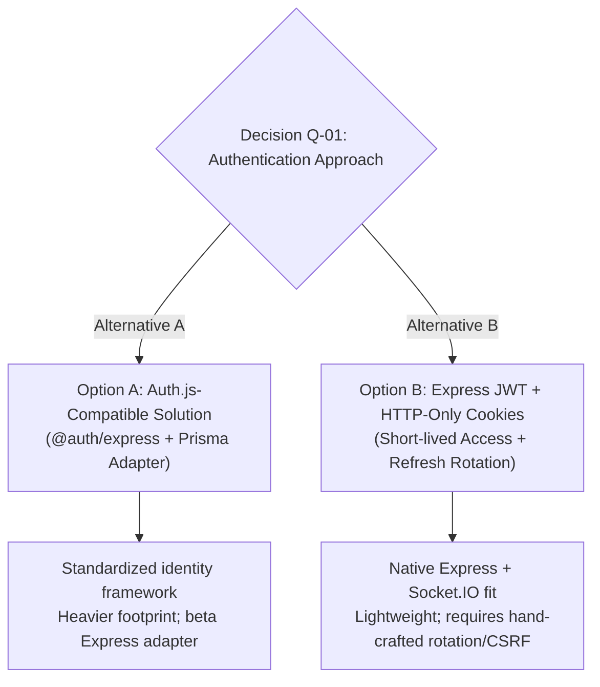

# Phase 3 — CP-3: Authentication Design & Dependency Review

**Status:** Implementation Planning & Architecture Gate  
**Branch:** `dev`  
**Latest Checkpoint Commit:** `856d929` (`feat: define identity and RBAC database schema`)  
**Normative Authorities:**
- `docs/project-baseline/refined/FINAL_DECISIONS_AND_SUPERSEDING_CORRECTIONS.md`
- `docs/project-baseline/refined/DATABASE_SCHEMA_REVISION_2.md`
- `docs/project-baseline/refined/api-specifications_FINAL.md`
- `docs/contract-review/PHASE_2_CONTRACT_REVIEW.md`

---

## 1. Executive Summary & Verification Context

Phase 3 Checkpoint 2 (CP-2) completed the relational modeling of the foundational identity and access management entities (`User`, `Role`, `Permission`, `RolePermission`, `UserRole`, `Institution`, `InstitutionMembership`, `AuditEvent`, `OutboxEvent`) and produced the static review migration artifact `init_identity_rbac_foundation`. These changes were committed and pushed to `dev` as `856d929`.

In strict adherence to the project roadmap and governance protocols:
1. **The database migration has NOT been applied to Neon.** Neither the `development` branch nor the root `neondb` branch has been modified. *(Historical note: migration was subsequently verified and applied in CP-7).*
2. **Q-01 status at the time of review:** The `User` model remains strictly provider-neutral; zero credential fields, password hashes, auth tokens, or session tables exist in the schema. *(Note: Q-01 was subsequently resolved by the project owner in favor of Option B in [`DECISION_RECORD_Q01_AUTHENTICATION_STRATEGY.md`](file:///c:/Users/shrey/Desktop/AICTE-Approval-Workflow/docs/contract-review/DECISION_RECORD_Q01_AUTHENTICATION_STRATEGY.md)).*
3. **No authentication code has been implemented.** No authentication packages have been installed; no login, registration, or session routes exist.

**CP-3 Objective:** Provide an evidence-based, architectural review of the two approved authentication approaches, establish concrete security and operational trade-offs, detail the downstream implementation requirements, address concurrency and immediate revocation realities, and formulate a clear recommendation without pre-empting the project owner's final decision on Q-01.

---

## 2. Authoritative Baseline Directives & Hard Constraints

From `FINAL_DECISIONS_AND_SUPERSEDING_CORRECTIONS.md` (§1, §2, §4) and companion documents, the following rules are non-negotiable:

| Directive | Source Citation | Binding Architectural Rule |
|---|---|---|
| **Better Auth Exclusion** | Final Decisions §1, §4.1 | **Better Auth is strictly prohibited.** It must not be installed, configured, or referenced in implementation code. |
| **Approved Direction** | Final Decisions §1, §2 | Authentication must use either an **Auth.js-compatible solution** or **JWT-based authentication with secure HTTP-only cookies**. |
| **Neon Service Boundaries** | Final Decisions §1, §2 | Neon is restricted **solely to PostgreSQL and private document/object storage**. Neon Auth and Neon Realtime are strictly prohibited. |
| **Token Storage Prohibition** | Final Decisions §4.5 | **Bearer/session tokens in `localStorage` or `sessionStorage` are strictly prohibited.** Tokens must never be accessible to client-side JavaScript. |
| **Cookie Security Attributes** | Final Decisions §4.2 | Cookies must enforce `HttpOnly`, `Secure` (in HTTPS environments), and an appropriate `SameSite` attribute (`Lax` or `Strict`). |
| **CSRF Mitigation** | Final Decisions §4.3 | Cross-Site Request Forgery (CSRF) protection is mandatory for cookie-based transport across origins (`http://localhost:5173` to `http://localhost:5000`). |
| **Real-time Push Transport** | Final Decisions §1, §3 | **Socket.IO is the selected transport.** Connection handshakes must be authenticated using the server-side auth design; Socket.IO events are non-authoritative notification hints prompting REST refetch. |
| **Statutory Authorization Boundary** | Final Decisions §4.4 | RBAC and institution/resource scope must be enforced on the backend for every protected API endpoint, Socket.IO room/event, and workflow transition. |

---

## 3. Existing Repository Architecture Inspection

### 3.1 Backend Application Skeleton (`backend/`)
- **Runtime & Framework:** Node.js (ES modules, `type: "module"`), Express `4.21.2`, TypeScript `5.6.3`.
- **Relational ORM:** Prisma Client `6.19.3` pinned, connected via pooled `DATABASE_URL` and direct `DIRECT_URL` (dual-endpoint Neon configuration).
- **CORS Configuration ([backend/src/app.ts](file:///C:/Users/shrey/Desktop/AICTE-Approval-Workflow/backend/src/app.ts#L13-L18)):**
  ```typescript
  app.use(
    cors({
      origin: env.CLIENT_URL, // http://localhost:5173
      credentials: true       // Enabled for cross-origin cookie delivery
    })
  );
  ```
- **Real-time Stub ([backend/src/sockets/index.ts](file:///C:/Users/shrey/Desktop/AICTE-Approval-Workflow/backend/src/sockets/index.ts)):** Socket.IO transport stub configured with comments mandating handshake authentication and room-level RBAC authorization.
- **Environment Validation ([backend/src/validators/env.validator.ts](file:///C:/Users/shrey/Desktop/AICTE-Approval-Workflow/backend/src/validators/env.validator.ts)):** Two-tier Zod validation ensuring database-independent operations run cleanly without credentials, while database-dependent operations validate configuration safely.
- **Current Auth Footprint:** **Zero auth dependencies.** `package.json` contains only `express`, `cors`, `dotenv`, `zod`, and `@prisma/client`.

### 3.2 Frontend Application Skeleton (`frontend/`)
- **Runtime & Tooling:** React `18.3.1`, Vite `6.0.1`, React Router DOM `6.28.0`, Tailwind CSS `3.4.16`.
- **Architecture:** Client-side Single Page Application (SPA) served on port `5173`.
- **State & Transport Implications:** Because the frontend is a separate origin SPA, authentication cannot rely on Next.js server-action cookies or SSR session injection. Any cookie-based transport must explicitly manage CORS credentials, `SameSite` semantics, and CSRF token discovery.

### 3.3 Database Identity Foundation ([backend/prisma/schema.prisma](file:///C:/Users/shrey/Desktop/AICTE-Approval-Workflow/backend/prisma/schema.prisma))
- **`User` (`users` table):** Contains `id` (UUID), `displayName`, `email` (nullable), `phone` (nullable), `status` (`ACTIVE`, `SUSPENDED`, `INACTIVE`), and timestamps.
- **Provider-Neutrality:** Zero credential fields. At the time of this review, the canonical mapping table `auth_identities` (`DATABASE_SCHEMA_REVISION_2.md` §4.2) was deferred pending Decision Q-01. Q-01 has since been resolved in favor of Option B with a separate `user_credentials` table (see [`DECISION_RECORD_Q01_AUTHENTICATION_STRATEGY.md`](file:///c:/Users/shrey/Desktop/AICTE-Approval-Workflow/docs/contract-review/DECISION_RECORD_Q01_AUTHENTICATION_STRATEGY.md)); neither credential nor refresh-token models have yet been implemented.

---

## 4. In-Depth Comparative Evaluation: Option A vs. Option B

### 4.1 Option A: Auth.js-Compatible Solution (`@auth/express`)

Auth.js (v5) provides framework-agnostic session management, standard adapter interfaces, and OAuth/OIDC provider abstractions.

#### Architectural Mechanics:
- Mounts an Express route handler (`/api/auth/*`) that processes OAuth callbacks, credential verification, and session lifecycle.
- Uses either database-backed sessions (via `@auth/prisma-adapter`) or encrypted JWE session cookies.
- Issues an `authjs.csrf-token` cookie and validates CSRF tokens on state-changing requests automatically within its handlers.

#### Evaluation for AICTE Workflow Architecture:
- **Strengths:**
  1. Standardized abstractions for external identity providers (e.g. Google OAuth, institutional SAML/OIDC, Digilocker).
  2. Built-in session encryption and cookie rotation logic.
  3. Pre-built Prisma adapter schemas available.
- **Risks & Impediments:**
  1. **Ecosystem & Maturity:** `@auth/express` is currently an experimental/beta package in Auth.js v5. Its APIs and middleware contracts have experienced frequent breaking changes.
  2. **SPA / Express Mismatch:** Auth.js is fundamentally architected for unified full-stack frameworks (Next.js, SvelteKit). In an Express REST API serving an independent Vite React SPA, client-side session retrieval (`getSession`) requires custom fetch layers or non-standard redirection endpoints.
  3. **Socket.IO Integration Friction:** To authenticate Socket.IO handshakes, the server must extract the encrypted Auth.js session cookie from the handshake headers and invoke internal `@auth/core` decryption routines, creating tight coupling to undocumented internal helper functions.
  4. **Database Schema Bloat:** If database sessions are used, Auth.js mandates `Account`, `Session`, and `VerificationToken` tables, creating provider-specific schema coupling before multi-provider requirements are even established.

---

### 4.2 Option B: Custom Express JWT with Secure HTTP-Only Cookies & Refresh Token Rotation

A modular, native Express authentication pipeline implementing short-lived Access Tokens and rotating Refresh Tokens via `HttpOnly` cookies, using standard, hardened primitives (`jose` or `jsonwebtoken`, `bcrypt` or `@node-rs/argon2`, `cookie-parser`).

#### 4.2.1 Core Architectural Mechanics:
1. **Access Token Lifecycle & Reality of Stateless Tokens:**
   - Provisional lifespan: 15 minutes (provisional default; subject to operational tuning during implementation).
   - Signed with HMAC-SHA256 (`JWT_ACCESS_SECRET`) containing safe claims (`sub: user_id`).
   - Delivered in an `HttpOnly`, `Secure` (production), `SameSite=Lax` cookie (`access_token`).
   - **Crucial Security Reality:** A stateless access token is self-contained. Once cryptographically signed and issued, **revoking a refresh token does NOT immediately invalidate an active access token**. An access token remains cryptographically valid until its `exp` timestamp unless the application explicitly implements a real-time status check.
2. **Immediate Account Suspension Enforcement:**
   - **The Problem:** When an administrator marks a user as `SUSPENDED` or `INACTIVE` in PostgreSQL, simply revoking refresh tokens prevents obtaining *new* access tokens, but leaves an existing access token functional for up to 15 minutes. In a statutory regulatory workflow, a suspended officer or institution user must not be permitted to submit cases or approve decisions during that residual window.
   - **Enforcement on Protected HTTP Requests:**
     The `authenticate` / `authorize` middleware must perform a lightweight status check against the database:
     ```sql
     SELECT id, status FROM users WHERE id = $1;
     ```
     If `status != 'ACTIVE'`, the request is immediately rejected with `403 Forbidden` (`ACCOUNT_SUSPENDED`), regardless of the JWT's cryptographic validity.
   - **Enforcement on Socket.IO Real-time Connections:**
     1. *Handshake Gate:* The Socket.IO connection handshake verifies the access token AND performs the same active account status query. Suspended accounts cannot establish a socket connection.
     2. *Post-Connection Suspension:* If an account is suspended *while* an active Socket.IO connection is already established, the system must not permit the user to receive sensitive push events or emit socket messages. The server must enforce account status checks before processing any incoming privileged socket event, and the administrative suspension service must emit an internal eviction event to disconnect the target user's active socket connections (`io.in(`user:${userId}`).disconnectSockets(true)`).
   - **Performance vs. Consistency Trade-off:**
     - *Pure Stateless JWT:* Maximum performance (zero database queries per request), but **weak consistency** (window of vulnerability up to 15 minutes upon suspension).
     - *Per-Request Persisted Status Check:* **Strong consistency** (immediate revocation the instant the database transaction commits). Performance cost: one indexed primary-key query per authenticated HTTP request (`users_pkey`). In a modular monolith connected to Neon via PgBouncer connection pooling, indexed PK lookups execute in <2ms, making this an acceptable and necessary trade-off for statutory compliance.
3. **Atomic Refresh Token Rotation & Concurrency Handling:**
   - **Database-Backed Refresh Tokens:** Refresh tokens (provisional lifespan: 7 days) are stored as cryptographic hashes in a `refresh_tokens` table.
   - **Atomic Transactional Consumption:**
     When `/api/v1/auth/refresh` is called, the exchange must run within an atomic PostgreSQL transaction with row-level locking:
     ```sql
     SELECT id, user_id, family_id, is_revoked, expires_at 
     FROM refresh_tokens 
     WHERE token_hash = $1 
     FOR UPDATE;
     ```
     The token is immediately marked `is_revoked = true` with `revoked_at = CURRENT_TIMESTAMP`, and a new token pair is inserted.
   - **Handling Concurrent Refresh Requests (Historical Proposal vs. Owner Resolution):**
     *Scenario:* In a React SPA, multiple components mounting simultaneously (or parallel API requests failing on an expired access token) can trigger simultaneous calls to `/api/v1/auth/refresh` with the *exact same* refresh token.
     *The Risk:* Without concurrency handling, a subsequent request reads `is_revoked = true`, mistakenly flags the event as an attack, revokes the entire token family, and logs out the legitimate user.
     *Historical Grace-Window Proposal (SUPERSEDED):*
     This review historically considered a server-side rotation grace period (10–15 seconds) where an immediately superseded refresh token would return the newly issued active replacement token rather than triggering revocation.
     > [!WARNING]
     > **Superseded by Owner Strict-Rotation Decision:** The server-side refresh grace-window proposal, its replacement-token behavior, and any mechanism allowing concurrent refresh requests to silently receive an already-issued raw replacement token based only on its hash have been **explicitly rejected and superseded** by the project owner in [`DECISION_RECORD_Q01_AUTHENTICATION_STRATEGY.md`](file:///c:/Users/shrey/Desktop/AICTE-Approval-Workflow/docs/contract-review/DECISION_RECORD_Q01_AUTHENTICATION_STRATEGY.md). Concurrent refresh requests must not silently receive an already-issued raw replacement token based only on its hash.
     *Approved Mitigation & Concurrency Handling:*
     1. *Client-Side Refresh Mutex:* The frontend API client (Axios or fetch wrapper) must implement an in-flight refresh mutex/queue: when an access token expires, only *one* refresh request is dispatched; all other concurrent requests within that tab await its resolution.
     2. *Limitation of Client Mutex:* The client refresh mutex is an effective in-tab mitigation, but it is **not a complete solution** to cross-tab races or lost responses (e.g., network drops after the server consumes the token).
     3. *Safe Failure and Re-authentication:* For ambiguous refresh outcomes (such as uncoordinated cross-tab requests or lost network responses), the system must fail safely by terminating the session and requiring user re-authentication, rather than silently reissuing replacement tokens, unless a separately reviewed secure recovery mechanism is later approved.
   - **Reuse Detection Status:** Strict reuse detection (revoking the entire token family if an already-consumed token is presented outside valid single-use rotation) is enforced as an owner requirement, paired with safe failure and re-authentication for ambiguous race conditions.
4. **CSRF Mitigation (Defense-in-Depth):**
   - **Limitation of Simple Equality:** Naive cookie/header equality alone is not sufficient, as an attacker with subdomain access or network injection capabilities could overwrite or inject client cookies.
   - **Required Multi-Layered Defense:** As confirmed in [`DECISION_RECORD_Q01_AUTHENTICATION_STRATEGY.md`](file:///c:/Users/shrey/Desktop/AICTE-Approval-Workflow/docs/contract-review/DECISION_RECORD_Q01_AUTHENTICATION_STRATEGY.md), CSRF protection must use a securely designed signed/session-bound token and rigorous allowed-origin validation as defense-in-depth:
     1. *Signed or Session-Bound Token:* The server issues an HMAC-signed or session-bound CSRF token (accessible in cookie `XSRF-TOKEN`) that the React SPA mirrors in header `X-XSRF-TOKEN`. Express middleware verifies the cryptographic signature or session binding, not merely string equality.
     2. *Rigorous Allowed-Origin Validation:* Mutating HTTP verbs (`POST`, `PUT`, `PATCH`, `DELETE`) are strictly validated against allowed origin headers (`Origin` / `Referer` matching `CLIENT_URL`).
     3. *Cookie Scoping:* Paired with deliberate `SameSite` attributes (`SameSite=Lax` or `SameSite=Strict` per deployed topology).

---

## 5. Concrete Trade-Off and Decision Matrix

| Dimension | Option A: Auth.js-Compatible (`@auth/express`) | Option B: Custom Express JWT + HTTP-Only Cookies | Analysis & Project Context |
|---|---|---|---|
| **Express Maturity** | Beta / Experimental in v5 | Fully stable, mature, battle-tested | Option B avoids pre-release framework instability. |
| **Vite React SPA Fit** | Awkward (designed for Next.js/SSR) | Natural (clean REST API endpoints) | Option B fits the repository's decoupled client-server structure. |
| **Socket.IO Auth** | Complex (internal JWE decryption) | Native (standard JWT cookie verify + socket eviction) | Option B natively supports Socket.IO handshake and event security. |
| **Token Storage** | Encrypted cookie or DB session | `HttpOnly` Access Cookie + Refresh Cookie | Both comply with the ban on `localStorage`. |
| **CSRF Defense** | Built-in for `/api/auth/*` handlers | Double-Submit Cookie / Custom Header | Option B applies consistent CSRF across all API routes. |
| **Immediate Revocation** | Requires session DB lookup per request | Enforced via persisted `User.status` check in middleware | Both require a database lookup for immediate suspension guarantees. |
| **Concurrency Resilience** | Managed internally by session engine | Requires client refresh mutex *(superseded proposal: server grace window rejected by owner in favor of strict rotation)* | Option B requires deliberate testing of race conditions. |
| **Schema Impact** | Requires Auth.js tables (`Session`, `Account`, etc.) | Single minimal `refresh_tokens` table | Option B minimizes schema footprint and preserves neutrality. |
| **Dependency Weight** | Heavy (`@auth/core`, `@auth/express`) | Lightweight alternatives (`jose` vs `jsonwebtoken`) | Option B keeps backend bundle lean and transparent. |

---

## 6. Neutral Presentation of Decision Q-01 (Historical Design Context — Formally Resolved)

> [!NOTE]
> **Resolution Notice (25 October 2026):** Decision Q-01 has been **FORMALLY RESOLVED** by the project owner in [`docs/contract-review/DECISION_RECORD_Q01_AUTHENTICATION_STRATEGY.md`](file:///c:/Users/shrey/Desktop/AICTE-Approval-Workflow/docs/contract-review/DECISION_RECORD_Q01_AUTHENTICATION_STRATEGY.md). The owner approved **Option B (Custom Express JWT with Secure HTTP-Only Cookies)** with a decoupled `user_credentials` table, `jose`, `@node-rs/argon2`, `cookie-parser`, strict refresh token rotation with a client-side mutex, and per-request account suspension checks. The comparison below is preserved for historical auditability.

To preserve owner governance at the time of review, the implementation path was presented neutrally without unilateral pre-emption. The historical decision alternatives evaluated are presented below:



### Historical Owner Confirmations to Close Q-01 (Formally Resolved):
*(Status: Closed and Confirmed on 25 October 2026 in [`DECISION_RECORD_Q01_AUTHENTICATION_STRATEGY.md`](file:///c:/Users/shrey/Desktop/AICTE-Approval-Workflow/docs/contract-review/DECISION_RECORD_Q01_AUTHENTICATION_STRATEGY.md))*
1. **Approach Selection:** **RESOLVED** — Approved **Option B (Express JWT with secure HTTP-only cookies)**.
2. **Local Credential Storage:** **RESOLVED** — Approved separate `user_credentials` table; `users` remains provider-neutral.
3. **Account Suspension Enforcement Level:** **RESOLVED** — Approved immediate per-request active status check (`User.status == 'ACTIVE'`) on protected HTTP requests and privileged socket events.
4. **Package Selection:** **RESOLVED** — Selected `jose`, `@node-rs/argon2`, and `cookie-parser`.

---

## 7. Implementation Path (Approved under Option B)

Following the project owner's approval of **Option B (Express JWT with secure HTTP-only cookies)** in [`DECISION_RECORD_Q01_AUTHENTICATION_STRATEGY.md`](file:///c:/Users/shrey/Desktop/AICTE-Approval-Workflow/docs/contract-review/DECISION_RECORD_Q01_AUTHENTICATION_STRATEGY.md), the approved implementation path is:

1. **Step 1: Dependency Selection & Installation**
   - Install selected token and hashing packages (differentiating packages with built-in types from those requiring `@types/*`).
2. **Step 2: Database Schema Delta (CP-4/CP-5)**
   - Add a minimal `RefreshToken` model to `schema.prisma`:
     ```prisma
     model RefreshToken {
       id         String    @id @default(uuid()) @db.Uuid
       userId     String    @map("user_id") @db.Uuid
       tokenHash  String    @unique @map("token_hash")
       familyId   String    @map("family_id") @db.Uuid
       isRevoked  Boolean   @default(false) @map("is_revoked")
       expiresAt  DateTime  @map("expires_at") @db.Timestamptz
       createdAt  DateTime  @default(now()) @map("created_at") @db.Timestamptz
       revokedAt  DateTime? @map("revoked_at") @db.Timestamptz

       user User @relation(fields: [userId], references: [id], onDelete: Cascade)

       @@index([userId])
       @@index([familyId])
       @@map("refresh_tokens")
     }
     ```
   - Add a separate, decoupled `UserCredential` model to preserve `User` provider neutrality:
     ```prisma
     model UserCredential {
       id           String   @id @default(uuid()) @db.Uuid
       userId       String   @unique @map("user_id") @db.Uuid
       passwordHash String   @map("password_hash")
       createdAt    DateTime @default(now()) @map("created_at") @db.Timestamptz
       updatedAt    DateTime @updatedAt @map("updated_at") @db.Timestamptz

       user User @relation(fields: [userId], references: [id], onDelete: Cascade)

       @@map("user_credentials")
     }
     ```
3. **Step 3: Middleware Pipeline**
   - Implement `authenticate` middleware to extract and verify the `access_token` cookie and perform the immediate `User.status == 'ACTIVE'` verification.
   - Implement `requirePermission(...keys)` and `requireInstitutionScope` middleware to enforce RBAC and tenant boundaries.
   - Implement CSRF double-submit validation middleware for state-changing routes.
4. **Step 4: Authentication Controller & Endpoints**
   - Implement Section 8.2 canonical endpoints:
     - `POST /api/v1/auth/login`
     - `POST /api/v1/auth/logout`
     - `POST /api/v1/auth/refresh` (with transactional locking and strict rotation; server grace window superseded)
     - `GET /api/v1/me`
5. **Step 5: Socket.IO Authentication Gateway**
   - Hook JWT and status verification logic into `io.use((socket, next) => ...)`.
   - Provide an internal event listener on user status change to evict active socket connections upon suspension.

---

## 8. Downstream Implementation Specifications (Post-Q-01)

### 8.1 Package Selection & Typing Analysis

The candidate packages represent alternatives requiring a final choice. Note that some packages bundle their own TypeScript definitions, while others rely on DefinitelyTyped:

| Functional Area | Candidate Package | Type Definition Source | Trade-off Analysis |
|---|---|---|---|
| **Cookie Parsing** | `cookie-parser` | Requires `@types/cookie-parser` | Standard Express middleware for parsing cookie headers into `req.cookies`. |
| **Token Handling (Alternative 1)** | `jose` | **Bundles own TypeScript types** | Modern, universal, zero-dependency Web Crypto-based library; native ESM. |
| **Token Handling (Alternative 2)** | `jsonwebtoken` | Requires `@types/jsonwebtoken` | Traditional, widely used Node.js library; synchronous and callback API styles. |
| **Password Hashing (Alternative 1)** | `@node-rs/argon2` (or `argon2`) | **Bundles own TypeScript types** | OWASP-recommended memory-hard hashing algorithm; highly resistant to GPU attacks. |
| **Password Hashing (Alternative 2)** | `bcrypt` | Requires `@types/bcrypt` | Classic slow-hash algorithm; widely understood and highly portable C-binding. |

*Note: While Q-01 and package selections (`jose`, `@node-rs/argon2`, `cookie-parser`) have been approved by the owner in [`DECISION_RECORD_Q01_AUTHENTICATION_STRATEGY.md`](file:///c:/Users/shrey/Desktop/AICTE-Approval-Workflow/docs/contract-review/DECISION_RECORD_Q01_AUTHENTICATION_STRATEGY.md), no packages will be installed until implementation commences in the designated authentication checkpoint.*

### 8.2 Planned Security Test Specifications
1. **Cookie Security Test:** Verify that login response sets cookies with `HttpOnly=true`, `SameSite=Lax`, and `Secure` (when `NODE_ENV=production`).
2. **CSRF Enforcement Test:** Verify that mutating requests (`POST /api/v1/*`) without a valid cryptographically signed/session-bound token and valid allowed-origin header return `403 Forbidden` (confirming defense-in-depth beyond naive cookie/header equality).
3. **Access Token Expiry Test:** Verify that an expired access token returns `401 Unauthorized`.
4. **Immediate Suspension Gate Test:** Verify that changing a user's status to `SUSPENDED` in the database immediately causes their next HTTP request with a cryptographically valid access token to return `403 Forbidden`.
5. **Socket.IO Eviction Test:** Verify that a suspended user's active Socket.IO connection is terminated upon suspension.
6. **Concurrent Refresh Mutex & Safe Failure Test:** *(Supersedes earlier grace-window test proposal)* Verify that in-flight refresh requests within a single client tab are serialized by the client refresh mutex so only one `/api/v1/auth/refresh` request is dispatched. Verify that uncoordinated concurrent refresh requests across tabs or lost responses do not silently receive already-issued raw replacement tokens based only on hash; ambiguous refresh outcomes must fail safely by terminating the session and requiring re-authentication.
7. **Refresh Token Reuse Detection Test:** Verify that attempting to reuse an already-revoked refresh token triggers immediate token family invalidation and revokes all active refresh tokens for the user.

---

## 9. Verification Summary & Next Steps

### 9.1 Verification Checklist

- [x] **Authoritative sources read:** Evaluated against `FINAL_DECISIONS_AND_SUPERSEDING_CORRECTIONS.md`, `DATABASE_SCHEMA_REVISION_2.md`, and `api-specifications_FINAL.md`.
- [x] **Repository inspected:** Analyzed `backend/package.json`, `frontend/package.json`, `backend/src/app.ts`, `backend/src/server.ts`, `backend/src/sockets/index.ts`, and environment validators.
- [x] **Immediate suspension addressed:** Documented the distinction between refresh token revocation and access JWT validity, specified per-request status checks, and detailed Socket.IO connection eviction.
- [x] **Concurrency & race conditions addressed:** Detailed atomic transaction locking, client-side mutexing, server-side grace windows (subsequently superseded by owner strict-rotation decision), and qualified reuse detection claims.
- [x] **Package typing accuracy:** Accurately classified packages with bundled types (`jose`, `@node-rs/argon2`) versus DefinitelyTyped dependencies (`@types/cookie-parser`, `@types/jsonwebtoken`, `@types/bcrypt`).
- [x] **Decision Q-01 preserved:** Neutral comparison of Option A and Option B provided without unilateral resolution (subsequently resolved by owner in favor of Option B in [`DECISION_RECORD_Q01_AUTHENTICATION_STRATEGY.md`](file:///c:/Users/shrey/Desktop/AICTE-Approval-Workflow/docs/contract-review/DECISION_RECORD_Q01_AUTHENTICATION_STRATEGY.md)).
- [x] **No implementation committed:** Zero dependencies added; zero auth code written; zero schema modifications made; Neon database untouched.
- [x] **Canonical manifest intact:** Baseline manifest checksums verified (12/12 files unchanged).

### 9.2 Downstream Roadmap Status
Following this review, non-auth database infrastructure was completed in CP-4 through CP-7 (Neon migration applied). Decision Q-01 has been formally resolved in favor of Option B in [`DECISION_RECORD_Q01_AUTHENTICATION_STRATEGY.md`](file:///c:/Users/shrey/Desktop/AICTE-Approval-Workflow/docs/contract-review/DECISION_RECORD_Q01_AUTHENTICATION_STRATEGY.md). Implementation of the authentication subsystem (credential models, session endpoints, middleware, and security tests) will proceed in accordance with the resolved decision record.
