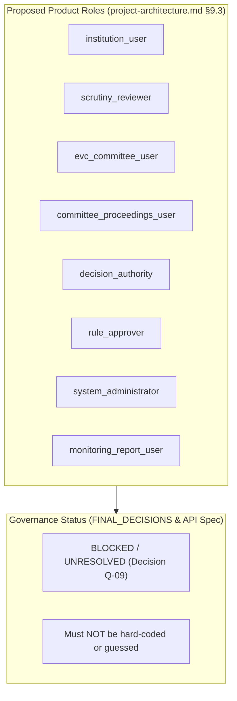

# Phase 3 — CP-5: Database Seed Strategy and RBAC Bootstrap Review

**Status:** Architecture Gate & Implementation Planning  
**Branch:** `dev`  
**Latest Checkpoint Commit:** `149af59` (`feat: establish database client and readiness checks`)  
**Normative Authorities:**
- `docs/project-baseline/refined/FINAL_DECISIONS_AND_SUPERSEDING_CORRECTIONS.md`
- `docs/project-baseline/refined/DATABASE_SCHEMA_REVISION_2.md`
- `docs/project-baseline/refined/api-specifications_FINAL.md`
- `docs/project-baseline/refined/project-architecture.md`
- `docs/project-baseline/refined/project-requirements.md`

---

## 1. Executive Summary & Gate Determination

Phase 3 Checkpoint 4 (CP-4) established the singleton Prisma Client foundation, dual-endpoint configuration (`DATABASE_URL` and `DIRECT_URL`), and integrated lifecycle management with separate process liveness (`/health/live`) and database readiness (`/health/ready`) checks, backed by 22 passing tests.

Checkpoint 5 (CP-5) requires determining which initial RBAC reference records are supported by the canonical baseline documents and establishing an idempotent seed-data foundation without modifying or connecting to Neon.

### Core Determination: Review Document is Required (Task 5)
In strict accordance with Task 3 and Task 5:
1. **The canonical project sources do NOT specify an approved role catalogue or permission matrix.**
2. `FINAL_DECISIONS_AND_SUPERSEDING_CORRECTIONS.md` (§2, line 29) explicitly affirms that the **role/permission matrix remains an open and unresolved decision**.
3. `api-specifications_FINAL.md` (§4.4, line 151 and §8.3, line 379) explicitly mandates: **"The final role catalogue and permission matrix are unresolved. Do not hard-code an unreviewed list of statutory roles or assume every project role can perform a decision... The final user-role catalogue and permission matrix are blocked."**
4. `DATABASE_SCHEMA_REVISION_2.md` (§E.2, line 2513) explicitly classifies: **"Decisions still blocked — do not guess: 2. Exact role/permission matrix, organisation hierarchy, and whether users can hold multiple institution-scoped roles."**
5. Implementing a seed script that inserts arbitrary roles or fabricated permissions would directly violate canonical governance and invent statutory workflow behavior.

Therefore, under **Task 5**, creating this focused review document to identify the missing owner decisions (Decision **Q-09**) and formulate a minimal safe seed plan is the authoritatively mandated action.

---

## 2. Authoritative Baseline Directives & Evidence Matrix

The canonical documents provide definitive guidance on RBAC definitions, seeding constraints, and prohibited assumptions:

| Directive | Source Citation | Canonical Rule & Explicit Prohibition |
|---|---|---|
| **Role/Permission Matrix Open** | Final Decisions §2, line 29 | *"No other unresolved decision is implicitly closed by this record. Email, queue/worker hosting, deployment, storage-security verification, **role/permission matrix**, API/schema alignment, regulatory currentness, and runtime test evidence **remain open as applicable**."* |
| **Prohibition on Hard-Coding Roles** | API Specifications §4.4, line 151 | *"The project discusses institution users, scrutiny officers, coordinators, administrators, committee/EVC participants, and other administrative actors. **The final role catalogue and permission matrix are unresolved. Do not hard-code an unreviewed list of statutory roles or assume every project role can perform a decision.**"* |
| **Catalogue Blocked** | API Specifications §8.3, line 379 | *"**The final user-role catalogue and permission matrix are blocked.** A user must not grant permissions to themselves or assign roles beyond their administrative scope. Changes to roles/memberships must be audited."* |
| **Decisions Blocked — Do Not Guess** | DB Schema Rev 2 §E.2, line 2513 | *"The following cannot be safely decided by a database design alone and **remain blocked until the project owner/provider/regulatory reviewer confirms them: 2. Exact role/permission matrix, organisation hierarchy, and whether users can hold multiple institution-scoped roles.**"* |
| **Seed Data Purity & Demarcation** | DB Schema Rev 2 §12, line 2206 | *"**Seed only technical roles/permissions and clearly labelled demo records.** Do not seed fake official decisions or imply that mock institutions/official records are real."* |
| **Separation of Duties** | Project Architecture §9.3, line 1096 | *"Roles may be split or combined only after reviewing the workflow and separation-of-duties requirements. **Do not grant official decision authority to a user merely because they are an administrator.**"* |
| **No Invented Job Titles** | Project Requirements §10.1, line 1004 | *"APH defines official roles/bodies and their functions, but does not specify software implementation details... **These roles must not be represented as official AICTE job titles.**"* |
| **Zero Credentials in Seed** | DB Schema Rev 2 §12, line 2209 | *"Keep secrets in environment variables/secret manager, **never in schema.prisma, migrations, seeds, logs, or frontend environment variables.**"* |

---

## 3. Analysis of Proposed Roles vs. Statutory Reality

`project-architecture.md` (§9.3) lists eight **proposed product roles**. However, these are expressly labeled as preliminary proposals, not approved statutory authorities:



### Critical Conflicts & Unresolved Boundaries:
1. **System Administrator vs. Statutory Authority:**
   - In standard software prototypes, administrators frequently receive wildcard permissions (`*`). In an AICTE regulatory workflow, granting approval or deficiency-issuing power to a system administrator is an illegal breach of statutory governance (`project-architecture.md` §9.3: *"Do not grant official decision authority to a user merely because they are an administrator"*).
2. **Scrutiny vs. Appellate Separation:**
   - Under the AICTE Approval Process Handbook (APH), officers who conduct Scrutiny or Expert Visit Committees (EVC) cannot participate in the Standing Hearing Committee (SHC) or Standing Appellate Committee (SAC) evaluating appeals on the same institution. A flat role assignment without institutional and committee separation-of-duties enforcement violates regulatory neutrality.
3. **Global System Roles (`UserRole`) vs. Tenant Membership Roles (`InstitutionMembership`):**
   - The relational schema cleanly separates platform-level roles (`roles` table mapped via `user_roles`) from institution-specific roles (`institution_memberships` table mapped via `membership_role` where CP-2 confirmed Option A active uniqueness).
   - A user representing an applicant engineering college is an `institution_user` globally, but within that institution holds a specific membership role (e.g. `HEAD_OF_INSTITUTION`, `FACULTY`, `NODAL_OFFICER`). Seeding global roles must not conflate tenancy memberships with global permissions.

---

## 4. Unresolved Owner Decisions (Decision Q-09: RBAC Bootstrap)

To unblock deterministic database seeding, the project owner must resolve the following concrete decisions:

### Q-09.1: Initial Technical Role Catalogue
Confirm whether the initial development database should seed the following baseline system roles:
- `system_administrator`: Technical maintenance, system monitoring, audit review. (Strictly prohibited from application approvals or regulatory decisions).
- `institution_user`: Standard applicant identity representing technical institutions.
- `scrutiny_reviewer`: Verification officer for initial document and deficiency scrutiny.
- `decision_authority`: Authorised statutory officer recording official Council recommendations.

### Q-09.2: Permission Naming Convention & Taxonomy
Confirm the standard permission naming syntax. The recommended pattern is `<domain>:<resource>:<action>`:
- `application:submission:create`
- `application:submission:read`
- `scrutiny:observation:create`
- `scrutiny:deficiency:issue`
- `decision:recommendation:record`
- `system:audit:read`
- `system:role:assign`

### Q-09.3: Baseline Role-Permission Mapping Matrix
Confirm the explicit assignment of permission keys to approved roles, ensuring strict adherence to separation of duties.

### Q-09.4: Fictional Demo Seed Scope
Confirm the extent of mock reference data permitted in local development:
- Purely fictional test institutions (e.g., `MOCK_INSTITUTION_001` — *"Fictional Demo Engineering College"*).
- Fictional provider-neutral user profiles without passwords or real personal details.
- Active prohibition on seeding real AICTE officer names, real institutions, or live approval cycles.

---

## 5. Proposed Minimal Safe Seed Plan (Contingent on Q-09)

Upon project owner confirmation of Decision Q-09, the following deterministic, idempotent seeding implementation will be deployed:

### 5.1 Architecture & Safety Principles
1. **Idempotency via `upsert`:** Every insert operation uses Prisma's `upsert` keyed on unique fields (`Role.key`, `Permission.key`, composite `RolePermission.roleId_permissionId`), allowing the seed script to be run repeatedly without duplicating records or throwing unique-constraint errors.
2. **Non-Destructive Execution:** The script **never** calls `deleteMany()`, `truncate`, or `drop`. Existing data remains fully intact.
3. **Environment Safety Gate:** The script executes only if `NODE_ENV !== 'production'`. Attempting to seed a production database will immediately throw an error and abort.
4. **Zero Credentials:** In strict alignment with Q-01, zero passwords, password hashes, or session tokens will be generated or stored.
5. **Synthetic Labeling:** All seeded entities will carry clear, unmissable synthetic prefixes (`MOCK_`, `DEMO_`, `isSystemRole: true`).

### 5.2 Draft Seed Implementation Blueprint (`backend/prisma/seed.ts`)

```typescript
import { PrismaClient } from '@prisma/client';
import dotenv from 'dotenv';

dotenv.config();

const prisma = new PrismaClient();

interface SeedRole {
  key: string;
  name: string;
  description: string;
  isSystemRole: boolean;
  permissions: string[];
}

// Minimal technical reference catalogue proposed for Q-09 confirmation:
const PROPOSED_PERMISSIONS = [
  { key: 'application:read', description: 'Read permitted application records' },
  { key: 'application:submit', description: 'Submit or resubmit application packages' },
  { key: 'scrutiny:read', description: 'View scrutiny observations and checklist items' },
  { key: 'scrutiny:write', description: 'Record scrutiny findings and observations' },
  { key: 'decision:record', description: 'Record official committee recommendation or decision' },
  { key: 'system:audit:read', description: 'Inspect audit trail and compliance event logs' }
];

const PROPOSED_ROLES: SeedRole[] = [
  {
    key: 'system_administrator',
    name: 'System Administrator',
    description: 'Technical platform administrator (strictly non-statutory; cannot record decisions)',
    isSystemRole: true,
    permissions: ['system:audit:read']
  },
  {
    key: 'institution_user',
    name: 'Institution Applicant',
    description: 'Authorized representative of an applicant institution',
    isSystemRole: false,
    permissions: ['application:read', 'application:submit']
  },
  {
    key: 'scrutiny_reviewer',
    name: 'Scrutiny Review Officer',
    description: 'Officer assigned to verify compliance checklists and document evidence',
    isSystemRole: false,
    permissions: ['application:read', 'scrutiny:read', 'scrutiny:write']
  },
  {
    key: 'decision_authority',
    name: 'Statutory Decision Authority',
    description: 'Authorised committee official recording statutory recommendations',
    isSystemRole: false,
    permissions: ['application:read', 'scrutiny:read', 'decision:record']
  }
];

export async function runSeed(client: PrismaClient = prisma) {
  if (process.env.NODE_ENV === 'production') {
    throw new Error('Deterministic development seeding is strictly prohibited in production.');
  }

  const databaseUrl = process.env.DATABASE_URL?.trim();
  if (!databaseUrl) {
    throw new Error('DATABASE_URL is required to execute database seed.');
  }

  console.log('[SEED] Starting idempotent database seed...');

  // 1. Seed Permissions
  const permissionMap = new Map<string, string>();
  for (const perm of PROPOSED_PERMISSIONS) {
    const record = await client.permission.upsert({
      where: { key: perm.key },
      update: { description: perm.description },
      create: { key: perm.key, description: perm.description }
    });
    permissionMap.set(record.key, record.id);
  }
  console.log(`[SEED] Seeded ${permissionMap.size} reference permissions.`);

  // 2. Seed Roles and Mappings
  for (const roleDef of PROPOSED_ROLES) {
    const roleRecord = await client.role.upsert({
      where: { key: roleDef.key },
      update: {
        name: roleDef.name,
        description: roleDef.description,
        isSystemRole: roleDef.isSystemRole
      },
      create: {
        key: roleDef.key,
        name: roleDef.name,
        description: roleDef.description,
        isSystemRole: roleDef.isSystemRole
      }
    });

    for (const permKey of roleDef.permissions) {
      const permId = permissionMap.get(permKey);
      if (permId) {
        await client.rolePermission.upsert({
          where: {
            roleId_permissionId: {
              roleId: roleRecord.id,
              permissionId: permId
            }
          },
          update: {},
          create: {
            roleId: roleRecord.id,
            permissionId: permId
          }
        });
      }
    }
  }
  console.log(`[SEED] Seeded ${PROPOSED_ROLES.length} reference roles with permission mappings.`);
  console.log('[SEED] Idempotent database seed completed successfully.');
}
```

---

## 6. Verification and Implementation Prerequisites

When Decision Q-09 is formally confirmed by the project owner:
1. **Prerequisites Gate:** Neon database migrations (`init_identity_rbac_foundation`) must be formally reviewed and applied to the Neon `development` branch before the seed script can interact with real tables.
2. **Package Configuration:** Configure `"prisma": { "seed": "tsx prisma/seed.ts" }` and script `"db:seed": "prisma db seed"` in `backend/package.json`.
3. **Unit Testing:** Implement `backend/tests/seed.test.ts` mocking Prisma Client calls to verify that:
   - `runSeed` throws when `DATABASE_URL` is missing.
   - `runSeed` throws when `NODE_ENV === 'production'`.
   - `runSeed` issues `upsert` queries for all roles and permissions without calling `delete` or `truncate`.

---

## 7. Roadmap & Next Steps

| Milestone | Scope & Deliverable | Current Status |
|---|---|---|
| **Phase 3 CP-1** | Dual-endpoint Neon configuration (`DATABASE_URL`, `DIRECT_URL`) | **Verified & Committed** |
| **Phase 3 CP-2** | Identity, RBAC, Tenancy Prisma schema & migration SQL | **Verified & Committed** |
| **Phase 3 CP-3** | Authentication design review (Q-01 alternatives, concurrency, suspension) | **Verified & Committed** |
| **Phase 3 CP-4** | Prisma Client singleton, lifecycle management, liveness & readiness probes | **Verified & Committed** |
| **Phase 3 CP-5** | Database seed strategy and RBAC bootstrap review (Decision Q-09 audit) | **Complete (This Review Document)** |
| **Phase 3 CP-6** | Migration application to Neon `development` branch & seed execution (Post Q-01/Q-09) | **Pending Owner Alignment** |
